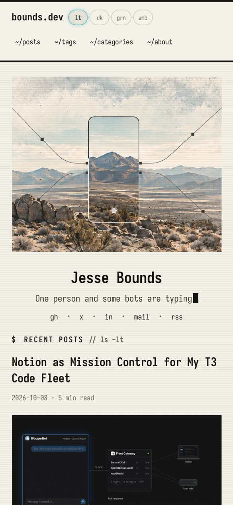
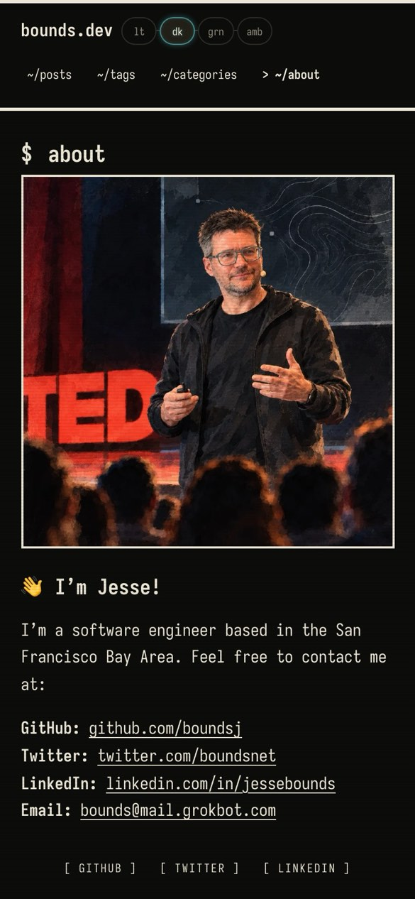
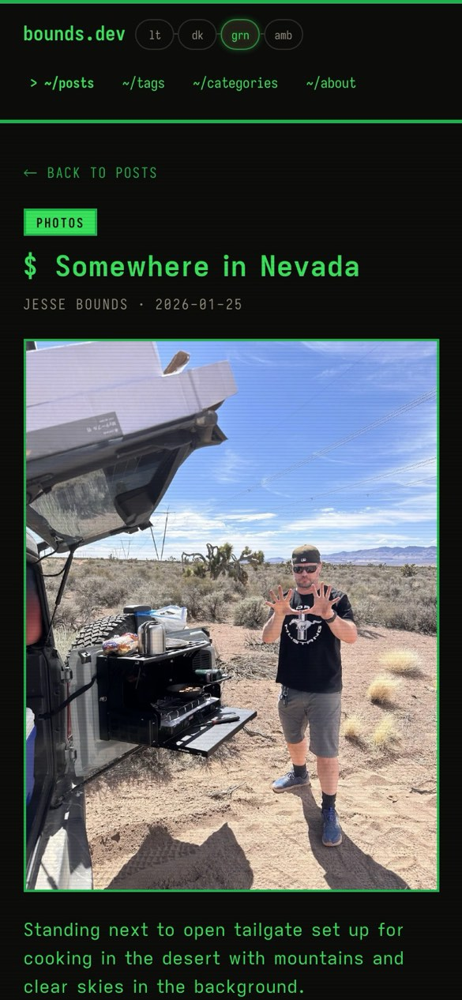
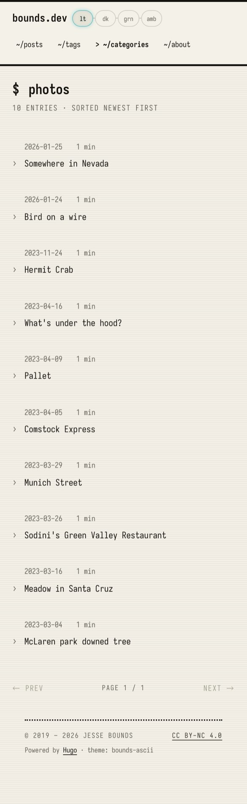
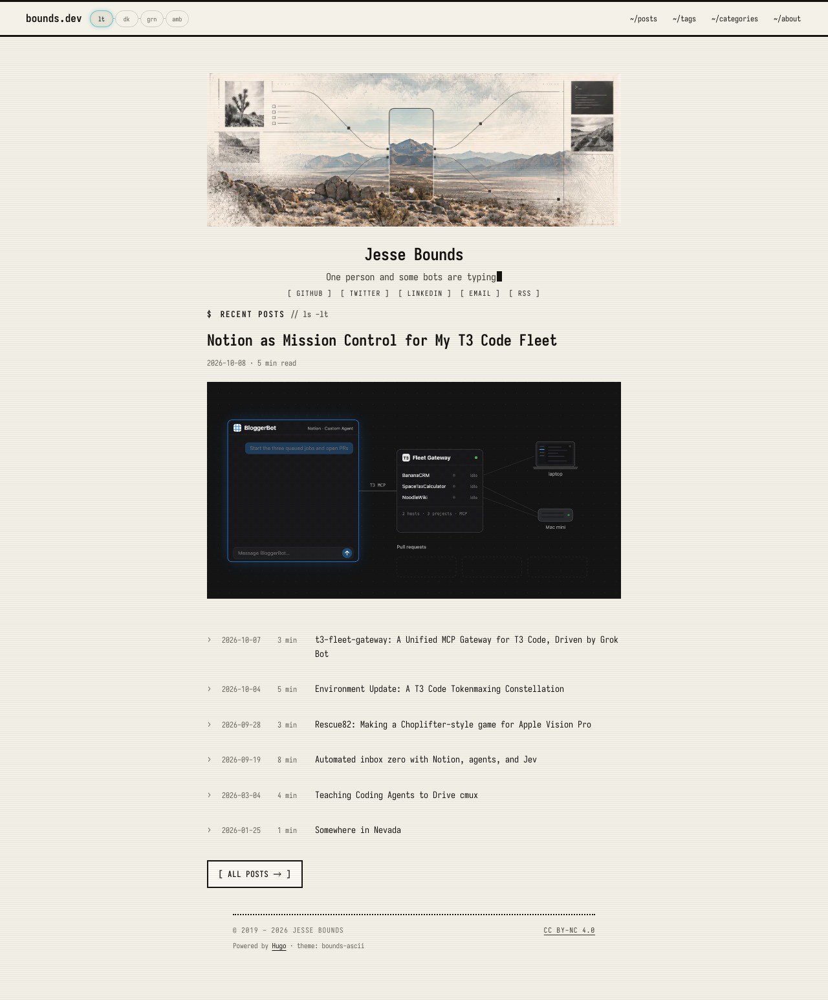
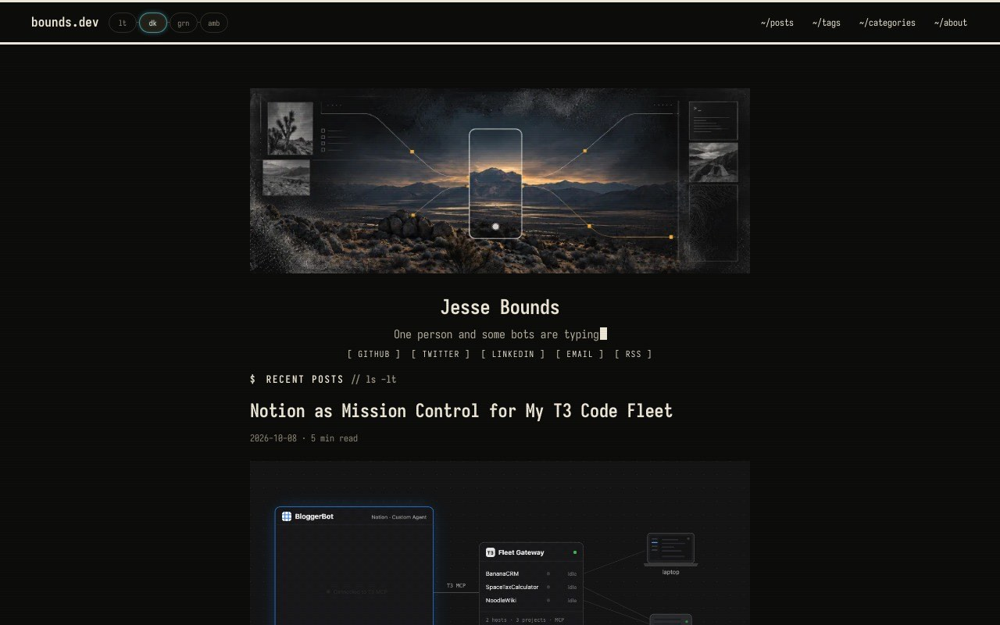
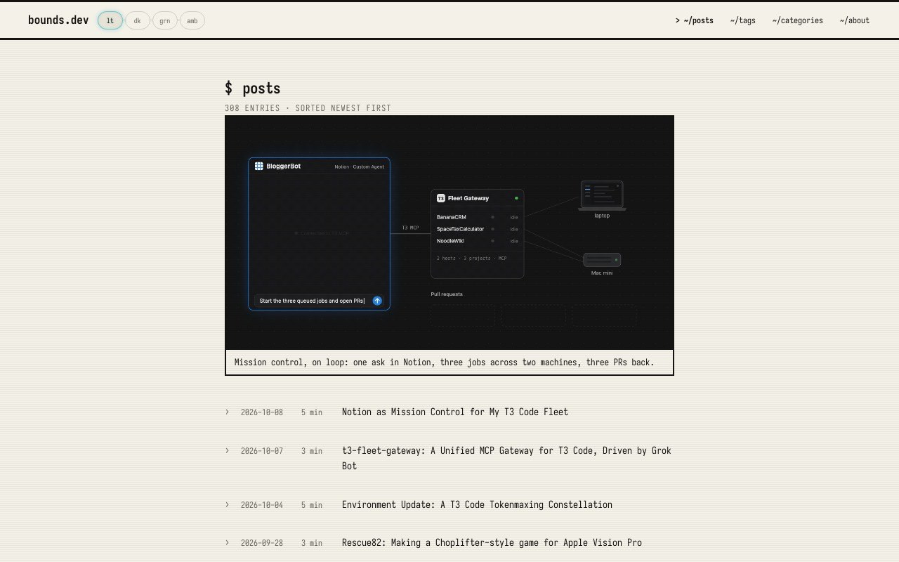
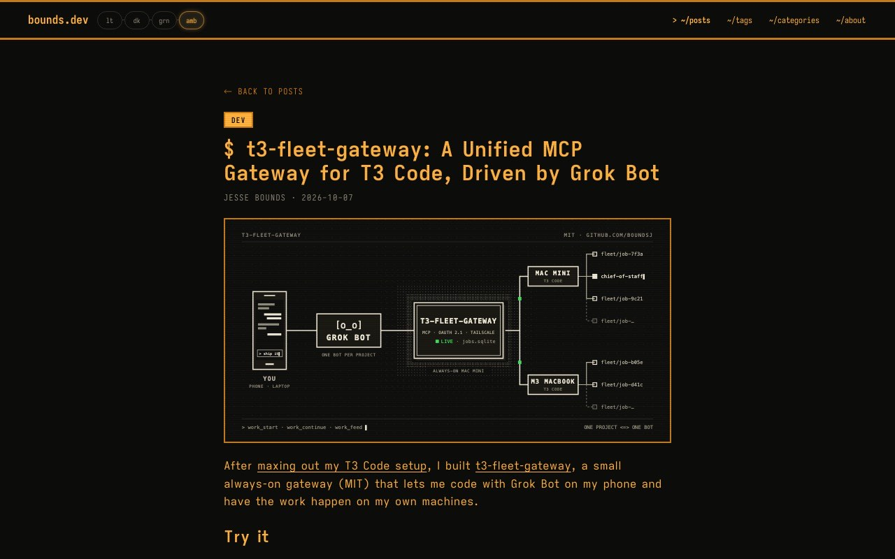

# bounds.dev design audit — 2026-10-17

Baseline: `03db69db6` (four-mode theme picker, Iosevka typography, About social preview). Hugo Extended 0.154.5, the version GitHub Pages uses.

## Method

- Built the site twice from the baseline. The development build was served locally for the browser pass. The production build (`hugo --minify`) was used to inspect the analytics markup.
- A headless Chromium (Playwright) loaded 7 pages: home, `/posts/`, a writing post (`t3-fleet-gateway`), a photo post (`somewhere-in-nevada`), About, `/tags/`, and 404. Each page ran at 390×844 (DPR 2, touch) and 1280×800, in all four themes: 56 views. Per view it recorded document overflow, header height, request count, transferred bytes, interactive targets under 24 px, computed text contrast below WCAG AA, heading outline, and console errors and warnings. Full-page captures of home and the photos category were added.
- Source review of `themes/bounds-ascii/`, the root `layouts/` overrides, `config.toml`, and the September audit (`docs/audits/2026-09-25-site-audit.md`).
- Content inventory: 308 published posts. 292 are generated limericks (PostbotGPT, 2023-04 to 2024-01), 10 are photo posts, 5 are `dev`, and 1 is `technology`.

This pass did not measure Core Web Vitals on real devices, test screen readers, or test browsers other than Chromium.

## Screenshots (before)

| | |
| --- | --- |
|  |  |
| Home, 390 px, light. The 104 px sticky header and the hero fill the first screen. | About, 390 px, dark. |
|  |  |
| Photo post, 390 px, green. The page-wide scanline overlay bands the photo. | `/categories/photos/` is the only photo index: text only, with "1 min" read times. |

`/posts/` page 1 shows the latest post's hero image with only a caption (no title or link), then lists the same post again as row 1.

## What works (keep)

- **The Field Signal hero is the best asset on the site.** It already shows both halves of Jesse's work: field photos and a topo map on one side, a `>_` terminal window on the other, wired by connector lines with square amber nodes around a phone/camera frame. The redesign should grow out of it.
- The four-mode pill switch (lt · dk · grn · amb) is distinctive and small. Pre-paint initialization prevents a flash of the wrong theme. The saved choice survives reloads, and legacy `paper`/`crt` values are migrated.
- Iosevka (self-hosted Latin subsets, about 30 KB per face) gives the site its character. Iosevka Aile makes long posts readable.
- The home page has a clear spine: hero, name, typed subtitle, the latest post once with its full hero, then ls-style rows.
- No horizontal overflow in any of the 56 views. No console errors on our pages.
- Good accessibility foundations: skip link, `aria-current` in the nav, `aria-pressed` on the theme buttons, a `:focus-visible` ring, `alt` text on heroes, and reduced-motion handling for the typed subtitle.
- Analytics are already kept out of `hugo server` (development environment).

## Findings

Priority: **P1** blocks a stated goal, **P2** is a clear defect or friction, **P3** is polish.

### Information architecture: photography is buried (P1)

1. **Photos have no visual way in.** The only photo index is `/categories/photos/`. It is reached through `~/categories`, it is text-only, and every photo shows a "1 min" read time. The nav has no photos link, and no thumbnail grid exists anywhere. The home page shows one photo title among six rows.
2. **Writing is mixed into a mostly generated archive.** `/posts/` lists 308 entries over 26 pages, and 95% of them are 2023–24 limericks. The six technical articles have no index of their own. Their descriptions, which are well written, are never shown in a list.
3. **Half of the nav is taxonomy.** `~/tags` and `~/categories` take two of the four slots. First-time visitors rarely use them, and they crowd out writing and photos.
4. **The archive hero is orphaned and duplicated.** `/posts/` page 1 shows the latest hero (1.2 MB GIF) with a caption but no title or link, then lists that post again. This contradicts the home page rule that the latest post appears once.
5. **Posts are dead ends.** "← back to posts" always goes to `/posts/`, even from a photo. There is no next or previous link. The category chip looks like a button but is a plain ``.

### Visual design (P2)

6. The page reads as a monochrome printout rather than a modern TUI. Modern TUIs such as lazygit, btop, k9s and Charm's Bubble Tea apps use titled panels, a status bar, a colored selection bar on the focused row, and color-coded kinds. None of these appear on the site. Its only accent is the cyan glow on the theme pill. The hero's amber nodes and connector lines are not echoed anywhere.
7. **The scanline overlay covers everything.** `body.scanlines::after` lays 5% black lines over text and photos. At DPR 2 it visibly bands photographs (see the Nevada screenshot), which works against showing off photography.
8. Rows carry no cue for the kind of post. A photo, an article, and a limerick look the same apart from the title.
9. Code blocks have no language label and no copy button.

### Usability for people who don't know terminals (P2)

10. The theme labels `lt dk grn amb` are cryptic, though their accessible names ("Light mode") are correct and tooltips appear on desktop. On phones, the home social links shrink to `gh · x · in · mail · rss`. Those abbreviations are terse, and the `x` target is 15 px wide.
11. On a 390×844 screen the sticky header is 104 px, 12% of the viewport, on every page.
12. On photo posts the read time ("1 min") carries no information.

### Accessibility (P2)

13. **Target size:** desktop nav links are 23 px tall. Social links are 18 px tall on desktop and 15–21 px wide on mobile. Pager links are 19 px, "← back to posts" is 19 px, and footer links are 13 px. These measurements alone don't prove a WCAG 2.2 SC 2.5.8 failure: the spacing and inline exceptions can apply (for example, the desktop nav has about 20 px gaps). Treat them as a usability problem, especially for touch, rather than a demonstrated compliance failure.
14. **Focus-ring coverage has gaps.** `:focus { outline: none }` removes outlines everywhere. `:focus-visible` restores them for generic `a` and `button` plus a list of component classes. Other focusable elements get no ring, including `summary`, form fields, `[tabindex]` elements, and native `<video>` controls. A single universal `:focus-visible` rule closes the gap.
15. **The typed subtitle empties its text and re-types it.** Assistive technology can announce partial text. The static string should stay available to screen readers.
16. **Contrast:** the theme tokens pass. `--fg-3` is at least 4.5:1 on every background in all four themes. Failures: the disabled pager `` (2.21:1, not interactive, but it looks like a link) and the third-party Mapbox scale control in dark themes (1.45:1). Lazy loading won't fix that; the control needs its own colors.
17. **Reduced motion is only partly respected.** CSS transitions are zeroed and the typing is skipped. But animated media keeps moving: the latest post's hero GIF (180 frames, 15 s, looping forever) has no `featuredImageStill`, so no still is offered under reduced motion. It also has no pause control, which WCAG 2.2.2 expects for motion that lasts longer than 5 s next to other content. The cmux post autoplays a looping video. That video has native controls, but it ignores reduced motion. CSS-only checks miss all of this.

### Performance (P2/P3)

Transferred bytes per page, measured locally without a cache:

| Page | Requests | Transferred | Largest items |
| --- | --- | --- | --- |
| Home | 10 | 1.37–1.44 MB | latest post's animated GIF hero (1.21 MB) |
| `/posts/` | 7 | 1.30 MB | the same GIF, repeated by the archive |
| Writing post (SVG hero) | 13 | 0.18–0.20 MB | — |
| Photo post | 21 | 0.71–0.75 MB | hero WebP 263 KB, Mapbox GL JS 215–261 KB (blocking script in `<head>`) |
| About | 7 | 0.18 MB | — |

18. The heaviest bytes are animated GIF heroes, which are content choices. The tokenmax post's GIF is 8.6 MB. Converting them to video is a content task outside this redesign. The redesign must not add GIF weight to new pages.
19. `mapbox-gl.js` loads synchronously in `<head>` on photo posts, before the map is anywhere near the viewport.
20. `dither.js` (1.9 KB) loads on every page, but no content uses `data-dither`.
21. Main CSS is 17.3 KB minified, theme JS 2.5 KB, and three Iosevka faces about 30 KB each. These are good budgets to keep.

### Analytics (P1 for goal 6)

`layouts/partials/google-analytics.html` adds `gtag.js` (`G-LT0HKHY2J5`) when `hugo.IsProduction` and `params.analytics.enable` are both true.

22. **Page views are the only data.** No events, no content grouping, and no way to tell writing traffic from photo traffic other than by URL.
23. **It is not guarded at runtime.** `hugo` builds default to the production environment. A local production build that is opened or served from `localhost` sends real page views. Any mirror on another host does too.
24. The snippet comes before `<meta charset>`. It still fits in the first 1,024 bytes, but the charset declaration belongs first.
25. `anonymizeIP = true` is never used. GA4 always anonymizes IP addresses, so the setting is dead config.
26. GA4 Enhanced Measurement is an admin setting we can't see or change. If it is on, it covers 90% page scroll, outbound `click`, and file downloads. It does not cover `mailto:` clicks, RSS, theme changes, article read depth (as opposed to page depth), the site's native `<video>` elements, or photo views. Custom event parameters show up in standard reports only after Jesse registers them as custom dimensions in GA admin. That is an admin task, documented in the proposal and out of scope here.

### Existing issues not addressed here

These are from the September audit and unchanged: Mapbox's `setSprite` style-diff warning on theme change, 302 posts without a `description`, `content/posts/cleanup.sh` published as a page, and no PR build gate in CI.

## Corrections after review

The reviewer (Codex GPT-6.1-Sol, round 1) found two overstated claims in the first draft of this audit. Both are fixed above. #14 had said the focus ring was limited to listed classes, but generic `a` and `button` were already covered. #13 had treated target sizes under 24 px as WCAG failures without checking the spacing exceptions. The reviewer also showed that #17 was materially incomplete: it had missed the looping GIF and the autoplaying video.

## Summary

The terminal foundation is strong and the hero already tells the story. The two biggest gaps are information architecture (photos have no front door, and writing is lost among 292 limericks) and analytics (page views only, no runtime guard). The next tier is TUI personality (panels, status bar, color-coded kinds, selection bars, motion), target sizes, and the scanline veil over photos. The proposal is in `docs/design-proposal-2026-10.md`.
