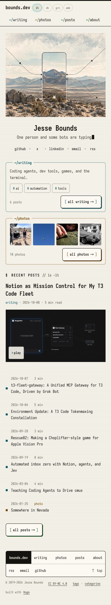
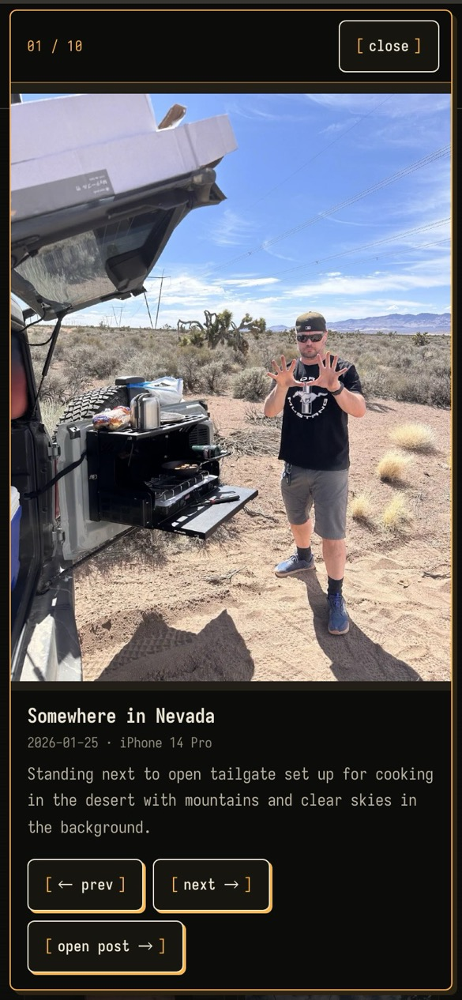
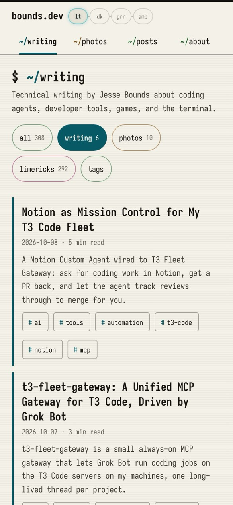
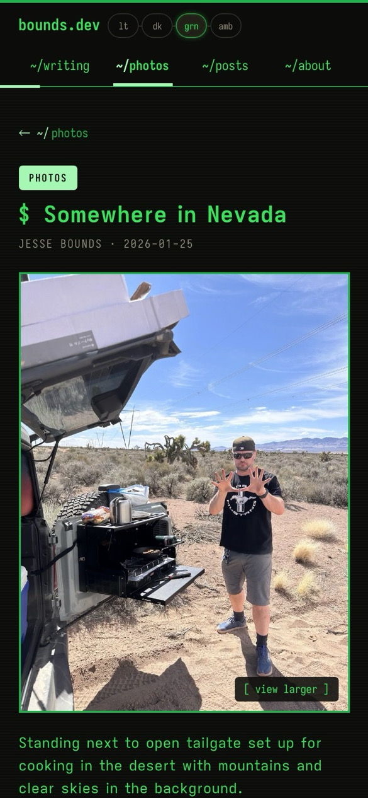
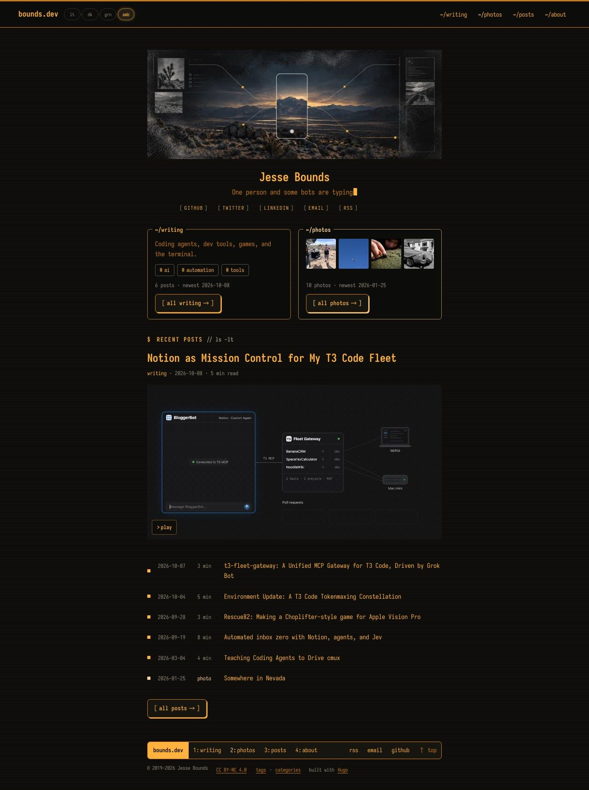
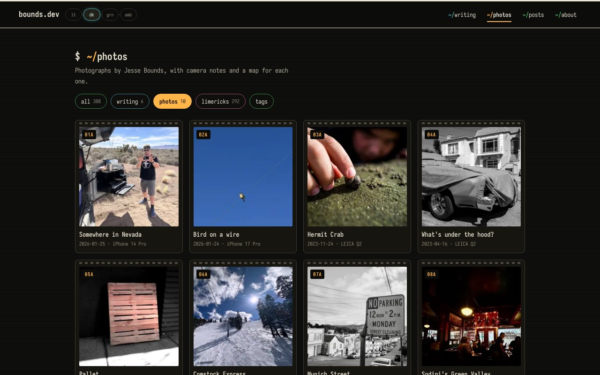
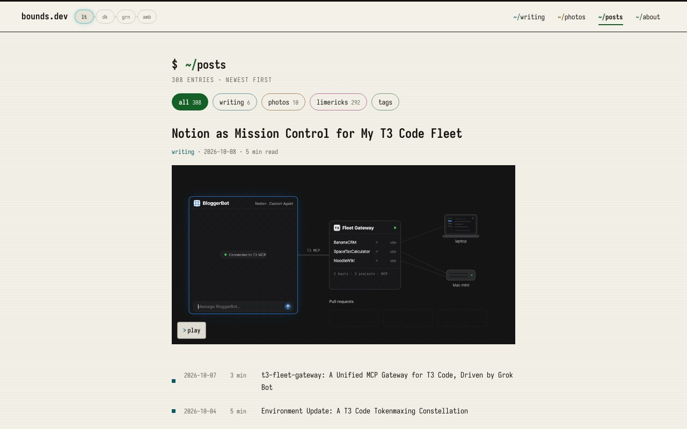
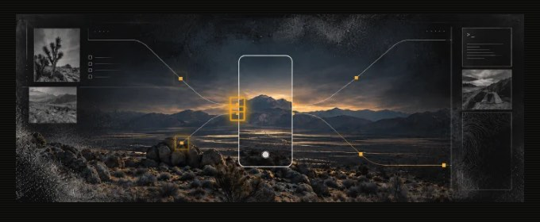
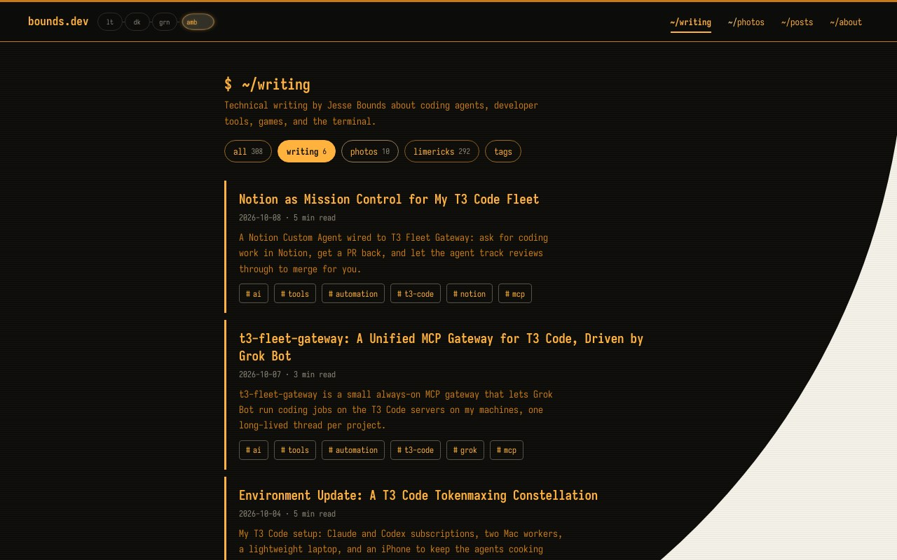
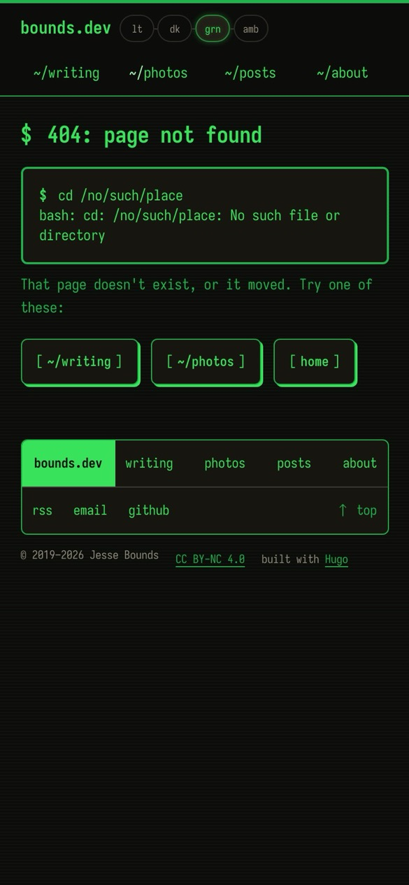

# bounds.dev redesign proposal: "Field Signal TUI" (2026-10)

Status: **v2, revised after reviewer round 1** (see the review log). It responds to `docs/design-audit-2026-10.md`. The review log at the end records reviewer critiques and decisions.

## Concept

The Field Signal hero already shows the site's two halves, joined by connector lines and square amber nodes: **field** (photographs, a topo map, a camera frame) and **signal** (a `>_` terminal). The redesign treats bounds.dev as a friendly TUI workstation with two first-class channels: `~/writing` (signal) and `~/photos` (field). The bot limericks remain as a third, quieter channel. The visual vocabulary comes from the hero and from modern TUIs (lazygit, btop, k9s, Charm's Bubble Tea and Lip Gloss): titled panels, a status bar, a colored selection bar, color-coded kinds, and square signal nodes.

Fun and dorky comes from TUI details: a theme change that wipes across the page from the pill, rows that light up like a selected list item, a footer status bar, a 404 that reads like a shell error, and a hero that "scans in" with pulsing signal nodes. Ease comes from plain words. Every control is a visible link or button with a 44 px touch target on phones and at least 24 px on desktop. No keyboard shortcuts are required.

## Retained (Jesse's established preferences)

- The four-mode pill sits just right of `bounds.dev` and stays small, rounded, with a sliding glow. Refinements: the glow takes the active theme's signal color, it stretches slightly while sliding, and theme changes use a View Transition wipe. Labels stay `lt dk grn amb` with their existing accessible names and tooltips.
- Iosevka Latin subsets everywhere and Iosevka Aile for post prose, all self-hosted. No new font files, no CDN, no VT323, no IBM Plex Mono.
- The subtitle typing animation and its cursor stay as they are. The full string moves into a screen-reader-only span, and the typed span becomes `aria-hidden` (audit #15). No other cursor or typing effects.
- The home page shows the latest post once, with its title, date and full hero image, and no box. Rows have no dividers, use regular-weight titles, and show ls-style dates and read times. The latest post never appears twice.
- Tight spacing and no awkward wrapping on phones.
- About keeps its og/twitter tags, `socialTitle`, TED image, and `bounds@mail.grokbot.com`.

### Proposed changes to established choices (flagged for Jesse)

1. **Nav:** `~/posts ~/tags ~/categories ~/about` becomes `~/writing ~/photos ~/posts ~/about`. Tags and categories stay reachable from `/posts/` (channel chips and a tags link) and from the footer. *Reason:* audit #1–3. Photos and writing need front doors, and taxonomy is low-value nav for first-time visitors.
2. **Photo rows show `photo` instead of `1 min`** in the read-time column, in every listing. *Reason:* audit #12. Writing rows keep their read times.
3. **Archive hero:** on `/posts/` page 1, the latest post's hero gets its title and a link, as on the home page, and rows start from the second post. *Reason:* audit #4. This keeps the recent decision to show a visual on the archive but fixes the orphan image and the duplicate row.
4. **Scanlines move off the content.** The 5% line texture becomes a page-background pattern behind content, never over photos or text. *Reason:* audit #7.
5. **Rounded panels:** new TUI panels and buttons use a 6 px radius, like Lip Gloss rounded borders. Photos and heroes keep square edges. *Reason:* modern TUI language. The baseline system said "radius 0 everywhere", though the pill is already rounded.

## Visual language

### Color: signal channels per theme

New tokens are layered on the existing ink/paper and CRT tokens, which are unchanged. Each kind of content gets a signal color for glyphs, labels, panel titles, selection bars and the progress bar. Body text stays `--fg-1`. Color is never the only cue: each kind also has a text label (`writing`, `photo`, `bots`).

| Token | light (paper) | dark (color CRT) | green (P1) | amber (P3) |
| --- | --- | --- | --- | --- |
| `--sig-write` (cyan) | `#075A65` | `#5FD7E6` | `#38E25B` | `#FFB23E` |
| `--sig-photo` (amber, from the hero nodes) | `#784500` | `#FFB547` | `#A6F7B4` | `#FFD592` |
| `--sig-bots` (magenta) | `#931C63` | `#FF7AC6` | `#2BC650` | `#E99A2C` |
| `--sig-ok` (green) | `#156028` | `#5BE37A` | `#38E25B` | `#FFB23E` |

Light and dark are the color modes. Green and amber stay faithful monochrome phosphor, so every channel maps to a brightness step of the phosphor. The tint is 13% of the signal mixed into `--bg-1`. Every signal value is at least 4.6:1 on `--bg-1`, `--bg-2` and `--bg-3`, and on its own tint laid over `--bg-1` or `--bg-3`. (v1's light values failed on the tint over `--bg-3`: 4.47:1, 4.22:1 and 4.12:1.) `--fg-3` meta text falls to 4.44:1 on the light photo tint, so tinted hover and selection states raise meta text to `--fg-2`. The browser harness checks the computed text/background matrix on every page, theme and width. The third-party Mapbox scale control gets its own colors in dark themes; it measured 1.45:1.

### Components

- **Panel (`.tui-panel`)**: a 1 px border and 6 px radius, with the title set into the top border (`╭─ ~/photos ─────╮`). It is built with CSS (an absolutely positioned title on the panel background), so it is real text, not box-drawing glyphs.
- **Selection bar**: on a row's hover or focus, a tinted background in the row's signal color slides in from the left, a `▌` marker appears, and the title underlines. Text stays `--fg-1`.
- **Kind label**: `writing`, `photo` or `bots` in small signal-colored text, with a square node glyph `■` borrowed from the hero.
- **Buttons**: bracketed labels such as `[ browse photos → ]` with a 1 px border, 6 px radius, and at least 44 px tall on touch screens. Pressing moves the button 1 px (a hard press).
- **Status bar footer**: one row with tmux-like segments: `bounds.dev` · `writing` `photos` `posts` `about` · `rss` `email` `github` · `↑ top`. Every segment is a plain, visible link. It wraps to two rows on phones. Copyright and license stay below it.
- **Code blocks**: a panel title with the language (`bash`, `text`, `yaml`) and a `[ copy ]` button that changes to `[ copied ]` for 1.5 s. Without JavaScript the button is absent.
- **Chips**: tag and category chips become real links with a 44 px touch area on phones.

### Typography

Unchanged families and weights. Section heads (`$ recent posts // ls -lt`) keep the prompt idiom. Uppercase tracked micro-labels are reduced to the byline and the status bar, so they stop reading as noise.

## Motion system

Tokens: `--dur-1: 120ms` (hover and press), `--dur-2: 220ms` (state changes), `--dur-3: 420ms` (entrances), `--ease-out: cubic-bezier(.22,1,.36,1)`, and `--ease-step: steps(6, end)` for scanner-like effects. Only `transform`, `opacity`, `clip-path` and `background-color` animate. Nothing animates layout.

| Moment | What happens | Notes |
| --- | --- | --- |
| Page entrance | Main sections rise 6 px and fade in, 40 ms apart, at most 6 steps | CSS only, `animation-fill-mode: both`. Content is visible if the CSS fails. |
| Hero scan-in | On the home page, the Field Signal art reveals top to bottom behind a thin bright scanline (about 700 ms, stepped) | Once per session (`sessionStorage`), skipped for reduced motion |
| Signal nodes | After the scan-in, small squares on the hero's nodes light up once, in sequence, like a signal crossing the diagram (about 2 s total) | **Finite: one pass, no loop** (WCAG 2.2.2). Opacity only. The node positions are percentages of the source art, with a second set for the 6:5 mobile crop, documented in the CSS. |
| Theme switch | Circular View Transition wipe from the pressed pill (about 380 ms). The pill glow slides with a slight stretch. | Progressive enhancement. Instant where unsupported or with reduced motion. |
| Animated heroes (GIF) | Each animated hero gets a small `[ pause ]` / `[ play ]` button. Under reduced motion it starts paused on a still. | The still is `featuredImageStill` if set; otherwise Hugo renders the GIF's first frame as a PNG. The toggle flips a `<picture>` source; no content changes. |
| Autoplaying video in posts | Under reduced motion, site JS pauses autoplaying `<video>` elements on load. Their native controls still play them. | Runtime only; the article markup is untouched. |
| Rows | The selection bar slides in (120 ms) | Hover and focus look the same |
| Links | The underline draws from left to right (160 ms) | Body links in prose stay plainly underlined |
| Doors and panels | Lift 2 px on hover. Photo thumbnails inside the photos door shift apart slightly. | |
| Photo tiles | Reveal on scroll (fade and 8 px rise). On hover the image scales to 1.04 inside its frame. | IntersectionObserver adds the class. Without JavaScript, everything is visible. |
| Lightbox | `<dialog>` scales from 0.96 and fades in (200 ms) | |
| Read progress | A 3 px bar in the post's signal color at the bottom edge of the sticky header | `transform: scaleX`, updated with rAF on scroll. With reduced motion it still updates, but without easing. |
| Copy button | Label swaps to `copied` | |

`prefers-reduced-motion: reduce` disables every animation and transition: entrances render in their final state, there is no scan-in, nodes are static, view transitions are skipped, and the lightbox opens instantly. Animated GIF heroes show their still until someone presses play, and autoplaying videos are paused. The typed subtitle keeps today's reduced-motion behavior. No animation, including JavaScript-driven ones, runs longer than 5 s without a pause control.

## Information architecture

### Header

Top row: `bounds.dev` and the pill (unchanged). Nav: `~/writing  ~/photos  ~/posts  ~/about` as visible links. Below 640 px they become a second row of four equal-width tabs, each 44 px tall. The header stays sticky. On phones its height drops from 104 px to 92 px through tighter padding; no nav is hidden.

### Home (`/`)

1. Field Signal hero (scan-in and nodes)
2. Name, typed subtitle, social links. On phones the links read `github · x · linkedin · email · rss`, in full words, at least 44×44 px.
3. **Two doors**, side by side on desktop and **stacked below 640 px** (v1 stacked only under 360 px, which left 390 px phones too cramped for four thumbnails):
   - `╭─ ~/writing ─╮`: one line of description, the top 5 writing tags as chips, `6 posts · newest <date>`, `[ all writing → ]`
   - `╭─ ~/photos ─╮`: 4 recent photo thumbnails, each a separate link of at least 78 px on a 390 px phone that opens the lightbox, `10 photos · newest <date>`, `[ all photos → ]`

   The doors show no post titles. **If the latest post is a photo, it is left out of the door strip**, so the latest post still appears only once.
4. `$ latest`: the latest post, once, with title, date, read time and full hero. No box (as today).
5. `$ recent posts // ls -lt`: the next 6 rows with kind labels.
6. `[ all posts → ]` and the status bar footer.

### `/writing/`

New section page, built from `content/writing/_index.md` with `outputs: [html]`. It lists every post in categories `dev` or `technology`, newest first, as `man`-style entries: title, a date · read time · kind line, the frontmatter `description`, and tag chips. There are no thumbnails, so the page stays fast and text-forward. A footer line links to the bot limericks and the full archive.

### `/photos/`

New section page (`content/photos/_index.md`): a **contact sheet**. It is a responsive grid with 2 columns on phones and 3–4 on desktop. Each tile is a frame numbered like a film strip (`01A`), with the date and title. Thumbnails are Hugo-processed WebP (`Fill 600x600`, about 30–60 KB). Tiles use a 240/480 px `srcset` with intrinsic dimensions, and every tile after the first four is lazy-loaded. Tapping a tile opens a lightbox:

- It is a native `<dialog>` opened with `showModal()`, so the background is inert and Tab stays inside. `aria-labelledby` points at the photo title, and `aria-describedby` at the caption.
- Initial focus goes to the close button. Esc, the close button and a backdrop click dismiss it, and focus returns to the tile that opened it.
- It shows the image (the same 480/960/1440 WebP files as the post hero, loaded only when opened), title, date, camera, caption, `[ ← prev ] [ next → ]`, `[ open post → ]` and `[ close ]`. Prev/next update the image, title and caption in place, and a polite live region announces the new title. Left/right arrow keys are an optional extra.
- On a 390 px phone and at 200% zoom, a portrait image and all controls fit without scrolling the page: the image is capped with `max-height` and the controls wrap.
- Without JavaScript, tiles are plain links to the posts. The page renders no GIF.

### `/posts/` (all)

Channel chips at the top: `all · writing · photos · limericks · tags`, with counts. They are links to `/posts/`, `/writing/`, `/photos/`, `/categories/generated/` and `/tags/`, so no client-side filtering is needed. Page 1 shows the latest post's hero with its linked title, and its rows start from the second item of the paginator slice (flagged change 3). Every post still appears on exactly one page. Rows carry kind labels. **The pager stays `<a href>` links** with the paginator URLs, styled as buttons. Unavailable ends are non-interactive ``s, dimmed and marked `aria-disabled`. Labels read `← newer` / `older →`.

### Single posts

- Back link: `← ~/writing` or `← ~/photos` depending on the kind (`~/posts` for bots).
- The category chip becomes a link.
- A read-progress bar.
- Code panels with copy buttons (writing posts).
- **Photo posts:** tapping the hero opens the same lightbox (without JavaScript, the link opens the original file). The EXIF table is styled as a TUI panel. **Mapbox loads lazily** (audit #19). `theme.js` gets one shared loader promise that injects the Mapbox CSS and JS when the first `.mapbox` container comes within 600 px of the viewport. Each container is initialized once (a `data-map-ready` guard) and registered in the existing `maps` registry, so theme restyling keeps working. The current theme is resolved at creation time. A failed load leaves a text fallback ("map unavailable") and never throws. Tests switch themes before load, after load, and after a blocked request.
- **Next and previous within the same channel**, at the end of the post, as two large links. Writing posts also get a single "meanwhile in `~/photos`" line with 3 thumbnails, so the two channels cross-link without burying each other.

### 404

`bash: cd: <path>: No such file or directory`, with buttons `[ ~/writing ] [ ~/photos ] [ home ]`. The path comes from `location.pathname`, inserted as text. It never reaches analytics: the page view uses a fixed `/404.html` location, and the 404 page sets `<meta name="referrer" content="origin">` so the next page view can't carry the bad path as its referrer.

## Analytics plan

### Loading, guard and URL hygiene (M1)

- `gtag.js` loads only when **all** of these hold: a Hugo production build, `params.analytics.enable`, and at runtime `location.hostname` is in `params.analytics.hosts` (`www.bounds.dev`, `bounds.dev`). The snippet moves after `<meta charset>`.
- In every other case (`hugo server`, `make preview`, local production builds, mirrors), `gtag.js` is never requested. A tiny `analytics.js` event layer still runs in **dev mode**. It logs each event to the console as `[analytics:dev] event_name {params}` and appends it to `window.__boundsAnalytics` for automated checks. Nothing leaves the browser.
- **Sanitized page context before the first `config` call.** `page_location` is `origin + pathname`, so query strings and fragments are never sent. On the 404 page it is the fixed `https://www.bounds.dev/404.html`, with `page_title: "404"`. `page_referrer` is reduced to `origin + pathname` for same-site referrers; cross-site referrers already arrive origin-only under the browser's default `strict-origin-when-cross-origin` policy. The 404 page also sets `<meta name="referrer" content="origin">`.
- `?analytics_debug=1` on the production host adds `debug_mode: true` for GA DebugView.
- The dead `anonymizeIP` setting is removed. GA4 never logs or stores IP addresses.
- Verification intercepts real production payloads. Playwright serves the production build at `https://www.bounds.dev/*` from disk, loads the real `gtag.js`, and **aborts every `/g/collect` request after recording it**. Nothing reaches GA, and the test asserts that no payload carries a query string, a 404 path, or an email address.

### Page-level context

- `content_group` (sent with `config`): `home`, `writing`, `photos`, `bots`, `archive`, `about`, `taxonomy`, `error` or `page`. This splits writing traffic from photo traffic in standard reports with no admin setup.
- User property: `gtag('set', 'user_properties', { site_theme })` runs before `config` with the theme active at load, and again on every theme change.

### Events

All names and parameters are snake_case. Parameters are reused across events. No event carries PII, visitor-entered text, query strings or email addresses. Outbound link paths are taken from Jesse's own authored links, with query strings and fragments removed.

| Event | Fires on | Parameters |
| --- | --- | --- |
| `select_content` (GA4 recommended) | Choosing **a specific post**: listing rows, the featured post (title or hero), writing entries, older/newer links | `content_type` (`writing`, `photo`, `bots`), `content_id` (post slug), `ui_location` |
| `nav_click` | Index-level navigation: header nav, status bar, channel chips, back links, door buttons, 404 buttons, tag and category chips, `all posts`, pager | `nav_item` (`home`, `writing`, `photos`, `posts`, `about`, `bots`, `tags`, `categories`, `top`, `page`), `ui_location` |
| `theme_change` | A pill press that changes the theme | `theme_from`, `theme_to` |
| `outbound_click` | A link to another host, except social links | `link_domain`, `link_path`, `ui_location` |
| `social_click` | GitHub, X/Twitter, LinkedIn | `social_network` (`github`, `x`, `linkedin`), `ui_location` |
| `email_click` | `mailto:` links | `ui_location` (no address) |
| `rss_click` | RSS links | `ui_location` |
| `read_progress` | Reading milestones on posts (definition below), once each per page view | `percent` (25, 50, 75, 100), `content_type`, `content_id`, `engaged_seconds` |
| `photo_open` | The lightbox opens, or pages to another photo | `content_id`, `ui_location` (`photo_grid`, `home_door`, `post_crosslink`, `post_hero`, `lightbox`), `method` (`click`, `next`, `prev`, `key`) |
| `native_video_start` | The first play of each native `<video>` per page view | `content_id`, `video_name` (file basename), `video_trigger` (`user`, `autoplay`) |
| `code_copy` | A code copy button | `content_id`, `code_language` |
| `motion_toggle` | The pause/play button on an animated hero | `content_id`, `state` (`paused`, `playing`) |
| `page_not_found` | The 404 page loads | none (`page_location` is the fixed `/404.html`) |

`ui_location` values: `header`, `footer`, `home_profile`, `door`, `home_latest`, `home_list`, `archive_latest`, `archive`, `chips`, `writing_list`, `photo_grid`, `post_body`, `post_nav`, `post_crosslink`, `back_link`, `about`, `pager`, `terms`, `404`, `lightbox`.

**Read depth.** The article body (`.post-content`) is the reference. Progress is `(viewport bottom − body top) / body height`, clamped to 0–100%. 100% means the bottom of the body has reached the bottom of the viewport. A short post that fits on screen counts as 100% on load. `engaged_seconds` counts only time with the tab visible.

**Overlap with Enhanced Measurement.** EM is an admin setting we can't see. If it is on, one outbound click sends both EM `click` (with `outbound: true`) and our `outbound_click`. Use `outbound_click` when you need `ui_location`, and EM `click` for raw totals. EM `scroll` (90% of the *page*) and our `read_progress` (the *article body*) measure different things. EM reports `video_start` only for YouTube embeds; our native videos use `native_video_start`, a different name. `docs/analytics.md` documents these pairs.

`docs/analytics.md` will document the schema, the guard, how to verify in dev mode and in GA DebugView, and which parameters Jesse should register as custom dimensions in GA admin (`ui_location`, `content_type`, `content_id`, `nav_item`, `percent`, `social_network`, `theme_to`, `link_domain`, `method`, the user property `site_theme`). Registering them is Jesse's admin step; this branch changes code only.

## Performance budget

- These are targets, not measured results: CSS at or under 28 KB minified, and JS at or under 14 KB minified across theme, site and analytics. **Measured after M4:** main CSS 35.4 KB minified (8.0 KB gzipped; baseline 17.3 / 4.5 KB) and the JS bundle 15.6 KB minified (5.6 KB gzipped; baseline theme + dither 4.5 / 2.3 KB). Both miss the raw targets, by 7.4 KB and 1.6 KB. Gzipped, they add about 6.8 KB to a first visit and nothing after caching. Accepted for now; see the open questions.
- No new fonts. No GIFs on new pages; door and contact-sheet thumbnails are WebP.
- Mapbox loads lazily, and `dither.js` loads only on pages that use `data-dither`.
- The home page adds the 4 door thumbnails (200 px WebP, about 10 KB each). Lightbox images load only when it opens.

## Milestones (each gets a reviewer pass and a commit)

1. **M1: Foundations, IA shell and the analytics guard.** Tokens and signal palette, universal `:focus-visible`, scanlines moved behind content, new nav, status-bar footer, target sizes, typed-subtitle accessibility, kind labels, `/writing/`, `/photos/` (static), archive chips and the archive hero fix, home doors, post back links and older/newer links. Also the **gtag runtime guard and URL sanitization** (moved up from M4).
2. **M2: Photos and media.** Lightbox (grid, doors, cross-links, post hero), lazy Mapbox with the shared loader and the scale-control colors, GIF pause/still, and reduced-motion video handling.
3. **M3: Motion and TUI details.** Entrances, hero scan-in with a single node pass, the theme View Transition and pill refinement, selection bars, underline draw, read-progress bar, code panels with copy, and the 404 shell error.
4. **M4: Analytics events.** `analytics.js` event layer and wiring, `content_group` and `site_theme`, `docs/analytics.md`, and the intercepted-payload test.

## Acceptance checks

- The `hugo --cleanDestinationDir` build passes on 0.154.5. `scripts/tests` (About image hooks and tag links) pass. `make check-private-hosts` passes.
- Playwright checks home, `/writing/`, `/photos/`, `/posts/`, a writing post, a photo post, About and 404 at 390 and 1280 in all four themes: no horizontal overflow, no console errors from site code, no standalone target under 24 px (44 px for the main touch controls on phones), and no text-contrast failures in site components.
- Reduced motion: with `reducedMotion: 'reduce'`, computed animation and transition durations are 0 on animated components, the hero has no scan-in, theme changes are instant, animated heroes show their still (the GIF itself is not requested), and autoplaying videos are paused.
- Lightbox: opens with `showModal()`; focus lands on close; Tab stays inside; Esc closes and focus returns to the tile; prev/next update the title and image; all controls are visible at 390×844 for a portrait photo.
- Lazy Mapbox: the map initializes when scrolled near, restyles on theme change before and after loading, and shows a fallback when the script is blocked.
- Analytics: in dev mode every event above is recorded in `window.__boundsAnalytics` with the documented parameters. No request goes to `googletagmanager.com` or `google-analytics.com` on `localhost` or the preview host, even from a production build. The intercepted production payloads hold no query strings, 404 paths or email addresses.
- Retained behavior: the theme key `bounds-crt` and legacy migration, pre-paint theming, Field Signal light/dark art selection, About og tags and email, RSS at `/index.xml`, existing permalinks and aliases, Mapbox theme restyling, and the home page's single latest post.

## Result (after M4 and review fixes)

| | |
| --- | --- |
|  |  |
| Home on a phone: hero, typed subtitle, the two doors, the latest post once (here paused on its still under reduced motion), ls rows with kind labels, and the status-bar footer. | The photo lightbox on a phone: counter, close, camera and caption, prev/next, and "open post". |
|  |  |
| `~/writing`: every article with its description and tags. | A photo post in green: the scanlines no longer band the photo, a "view larger" control, channel back link, and the reading-progress bar under the header. |

| | |
| --- | --- |
|  |  |
| First home view: the art scans in, then a signal crosses its nodes once. | Theme switch: the new theme grows in a circle from the pressed pill. |

## Review log

### Round 1: audit and proposal v1 (`be57745a1`)

Reviewer: Codex GPT-6.1-Sol at xhigh reasoning. Verdict: "proceed with listed changes." Each item was checked against source before deciding.

| # | Finding | Decision |
| --- | --- | --- |
| 1 | P1: default GA config sends the full URL, so a 404 path or query string can leak PII, contradicting the plan | **Accepted.** Sanitized `page_location`/`page_referrer`, a fixed 404 location, an origin-only referrer on 404, and an intercepted-payload test. The guard moves to M1. |
| 2 | P1: the latest hero GIF loops for 15 s with no still and no pause; the cmux video autoplays; the proposed node loop is infinite | **Accepted.** Verified: `notion-fleet-hero.gif` has no `featuredImageStill`. Added the GIF pause/still toggle (first frame generated by Hugo when no still is set), reduced-motion pausing of autoplay video, and a single finite node pass. |
| 3 | P2: light palette fails 4.5:1 on its tint over `--bg-3`; Mapbox scale is 1.45:1 | **Accepted.** Reproduced 4.47/4.22/4.12:1 and picked darker values (all ≥ 4.6:1). Meta text goes up to `--fg-2` in tinted states. Mapbox scale colors fixed in M2. |
| 4 | P2: side-by-side doors can't fit 4 tappable thumbnails at 390 px | **Accepted.** Doors stack below 640 px, giving four ~78 px thumbnails per row. |
| 5 | P2: a photo as the latest post would reappear in the door strip | **Accepted.** The featured post is excluded from the strip. |
| 6 | P2: `video_start` is an Enhanced Measurement name; EM `click` overlaps with `outbound_click` | **Accepted.** Renamed to `native_video_start` with `video_trigger`, and documented the overlap pairs. |
| 7 | P2: the event contract doesn't match the UI (doors as `select_content`, no limericks `nav_item`, ambiguous read depth, unclear user property) | **Accepted.** Control-by-control mapping, explicit read-depth geometry, and `user_properties` set and updated. |
| 8 | P2: the pager must stay links | **Accepted.** Already links in code; v1's wording ("real buttons") was wrong and is fixed. |
| 9 | P2: lazy Mapbox needs a loader, an init guard and registry integration | **Accepted.** Design specified above, with tests. |
| 10 | P2: the lightbox needs behavioral acceptance checks | **Accepted.** Added `showModal`, naming, initial focus, return focus, and a phone-fit check. |
| 11 | P2: the audit overstated the focus-ring gap and treated small targets as WCAG failures | **Accepted.** Audit #13 and #14 corrected and noted under "Corrections after review". |
| P3 | Defer the circular theme wipe, hardcoded node overlays and thumbnail fanning; responsive thumbnails; on-demand lightbox images | **Partly accepted.** Kept the theme wipe: goal 3 asks for more delight, it's a progressive enhancement with an instant fallback, and it costs about 30 lines. Kept the node overlay but made it one finite pass, with documented coordinates. Dropped thumbnail fanning. Added a thumbnail `srcset`, and lightbox images load only when it opens. |

### Round 2: M1 (`80302757a..a5174ec4a`)

Verdict: "no P1 blocker." The reviewer confirmed that every post appears exactly once across 26 archive pages, that RSS and aliases are byte-identical to baseline, that About metadata and email are intact, and that the guard makes no Google requests off-host.

| # | Finding | Decision |
| --- | --- | --- |
| 1 | P2: dim amber meta text is 4.48:1 on the photo tint | **Accepted.** New `--meta-on-tint` token, `--fg-1` in amber (now 8.34:1). |
| 2 | P2: chips, tags and the X link miss the 44 px phone target | **Accepted.** Chips are 44 px; tags are 32 px with an invisible 44 px hit band; X is at least 44 px wide. Round 3 found the door tags still short, which is fixed in round 3's commit. |
| 3 | P2: About reports `content_group: "page"` | **Accepted.** About is a root page bundle with no section; the partial now matches `layout: about`. |
| 4 | P2: photo posts without a hero vanish from `/photos/` | **Accepted.** The tile renders with a "no image" frame and no lightbox attributes. |
| 5 | P2: `/categories/` has no inbound links | **Accepted.** Footer links go to tags and categories. |
| P3 | `/posts/` jumps from h1 to h3 | **Accepted.** The archive feature uses h2. |

### Round 3: M2 + M3 (`a5174ec4a..54869b0bb`)

Verdict: "request changes for the three P2 findings." The reviewer confirmed the lightbox's naming, Tab containment, Esc and return focus on all ten photos at 390×844, reduced-motion behavior, map theming before and after load, and node alignment in both art versions. Subjectively, it said, "the motion fits the brief."

| # | Finding | Decision |
| --- | --- | --- |
| 1 | P2: door tags still 26 px (a more specific rule won); GIF toggle 32 px | **Accepted.** Fixed the override and the hit-band offset (`inset` is measured from the padding box, so 7 px gives 44 px), widened the row gap to 14 px, and made the toggle 44 px. Verified by hit-testing 5 px above and below a tag. |
| 2 | P2: turning on reduced motion mid-visit leaves the GIF playing | **Accepted.** The toggles subscribe to the media query. |
| 3 | P2: a Mapbox constructor failure (no WebGL) leaves a blank map marked ready | **Accepted.** Clears partial markup, shows the fallback, and marks ready only after creation. Verified with WebGL forced off. |
| P3 | Long captions push lightbox controls out of view at 200% zoom | **Accepted.** The image stage shrinks first. Verified at 640×400 with no internal overflow. |
| Note | LCP measured 244 ms with motion versus 56 ms reduced, because the entrance faded large blocks from opacity 0 | **Accepted.** Heroes, article text and doors now only slide. Re-measured at 52 ms versus 44 ms. |
| Note | Main CSS is 35.4 KB, over the 28 KB target | **Accepted as a known gap.** Recorded under the performance budget (8.0 KB gzipped). |

The lead also capped the subtitle cursor at six blinks (about 6 s), after which it stays solid, after the motion probe showed it blinking forever (WCAG 2.2.2). The cursor itself stays; this is flagged for Jesse.

### Round 4: M4 analytics (`54869b0bb..bcc7e1730`)

Verdict: "request changes; fix the P1 privacy leak before shipping M4." All collect requests in the reviewer's tests were intercepted and aborted.

| # | Finding | Decision |
| --- | --- | --- |
| 1 | P1: Enhanced Measurement's site search reads the raw query, so `/?q=jane@example.com` sent `search_term: jane@example.com` despite the sanitized `page_location` | **Accepted.** Before `gtag.js` loads, the snippet removes every parameter except `utm_*` (without `@`) from the address bar and from `page_location`. This also restores campaign attribution, which M1's strip-everything approach had silently lost. The production check now covers `q`, `s` and `search` on normal and 404 pages, and fails on the old build. The content audit found no outbound links with queries or `@` for EM's `link_url`. |
| 2 | P2: "↑ top" on a post records `select_content` | **Accepted.** Same-page anchors are classified first; added a post-page assertion. |
| 3 | P2: modified clicks on photos record the wrong type, and the hero's image file counts as a post selection | **Accepted.** Photo links carry `data-kind="photo"`; modified clicks go by destination (post page → `select_content`, image file → `photo_open`, `method: new_tab`). Plain, modifier and middle clicks are each tested. |
| 4 | P2: the production check loses beacon evidence across navigation and can't read Blob bodies | **Accepted.** Beacons are recorded through a context binding with Blob/ArrayBuffer/FormData decoding, plus a self-test that an unsafe beacon is recorded and flagged. |
| 5 | P2: a system appearance change leaves `site_theme` stale | **Accepted.** A MutationObserver on `data-theme` updates the user property however the theme changes; the production check covers the system switch. |
| P3 | Docs: custom parameters aren't visible in Explorations before registration | **Accepted.** Corrected, including the 24–48 hour delay. |
| P3 | `ui-check`'s lazy-Mapbox assertion was vacuous | **Accepted.** It now asserts zero requests while the map is beyond the 600 px margin, plus a fixture assertion that it is. |

### Round 5: verification of the round-3 and round-4 fixes (`54869b0bb..f46834901`)

Verdict: "not ship-ready … until the lightbox regression is fixed." Every other fix passed the reviewer's own reproduction: five search keys on home, post and 404 pages; safe and unsafe `utm_*` values; debug mode; history navigation; system theme updates; plain, modified and middle photo clicks; "top" on posts; tag hit areas; reduced motion turned on mid-visit; and three Mapbox failure modes.

| # | Finding | Decision |
| --- | --- | --- |
| 1 | P2: the round-3 lightbox change cropped photos. `max-height: min(100%, …)` resolved against an indefinite stage height, so the image overflowed and was clipped (an 818 px image in a 135 px stage at 640×400) | **Accepted.** The lead's own round-3 check had measured only the controls' position, not the photo, so it missed this. The dialog now has a definite height and a grid layout; the photo fills its stage with `object-fit: contain`; and the info row scrolls on its own when space runs out. `ui-check` now asserts that the whole rendered photo, the stage and the controls fit for all 10 photos at 390×844, 640×400 and 1280×800. |

Two later commits were verified by the lead only, because the review cycle limit had been reached. One is the fix above. The other keeps links inside a base path: literal `"/x/" | relURL` links escaped `/bounds-preview/`, as the existing "all posts" button already did. Verification: production `href`s are byte-identical on 7 sampled pages, the preview has no unprefixed links, and a click-through across nav, chips, entries, back link, footer, pager and brand stays under the prefix.

## Jesse's review (2026-10-17)

**Kept as built:** tags and categories out of the main nav; `photo` and `bot` in place of read times on photo and limerick rows; the latest-post hero on `/posts/`, not repeated in the list; scanlines behind the content; 6 px rounded corners; the subtitle cursor blinking six times, then staying solid; non-`utm_*` query parameters stripped from the address bar. The CSS stays as is (no trimming). GA custom definitions will be registered by hand later; the corrected list is in `docs/analytics.md`.

**Done in response:**

1. **Animated WebP heroes.** Each GIF hero now has a same-named `.webp` in its bundle, made with libwebp 1.6.0's `gif2webp` by `scripts/gif-to-webp.sh` (since replaced by the automated `scripts/gif-heroes.py`; see the next section). The hero layout serves the WebP; the GIF stays in the repo, still published at its old URL, and is the `` fallback. The pause/play toggle and the reduced-motion still work as before. Social previews are unchanged (`og:image`, `twitter:image` and JSON-LD all point at each post's `social-card.png`/`.jpg`).

   | Hero | GIF | WebP | Mode | Frames / total / loop (GIF → WebP) |
   | --- | --- | --- | --- | --- |
   | `notion-fleet-hero` | 1,240,287 B | 778,894 B (62.8%) | lossless, pixel-identical | 180 → 175 frames (identical frames merged), 15.00 s → 15.00 s, forever → forever |
   | `tokenmax-visual-loop` | 8,628,610 B | 2,156,744 B (25.0%) | mixed q80 | 150 → 150, 15.00 s → 15.00 s, forever → forever |
   | `preview` (Rescue82) | 771,062 B | 180,090 B (23.4%) | mixed q80 | 22 → 22, 3.67 s → 3.67 s, plays once → plays once |

   Every file passed `anim_diff -min_psnr 40`, which compares pixels per frame, frame timing and loop count. Chromium's own `ImageDecoder` reports the same frame durations and repetition counts for each GIF/WebP pair. Hugo's built-in WebP encoder was tried first and rejected: it crashed on the Notion and Rescue GIFs, and only got tokenmax down to 5.4 MB.

   Page weight on a fresh visit (1280 px, motion allowed): home 1,438 → 989 KB; `/posts/` 1,363 → 913 KB; Notion post 1,454 → 1,005 KB; tokenmax post 8,894 → 2,393 KB; Rescue82 post 1,016 → 440 KB.

2. **`docs/analytics.md`** now registers `percent` as an event-scoped dimension (not a metric) and adds `engaged_seconds` as a custom metric in seconds. It also notes the `photo_open` fallback `ui_location: "photo"`, that `content_group` rides on every event, and that empty parameters are dropped.

## Jesse's review of the preview (2026-10-17)

1. **Social links off-center on desktop.** Root cause: the list inherited the base `ul { max-width: var(--measure) }` rule (66ch = 528 px) and sat left-aligned in the 640 px column, so its centered links landed about 56 px left of the title. Phones weren't affected because their column is narrower than the cap. Fixed with `max-width: none`; `ui-check` asserts the row is centered under the title at 390, 768, 1024 and 1280 px.
2. **GIF → WebP is automatic.** `scripts/gif-heroes.py` finds every GIF hero. `scripts/gif-heroes.lock` records the SHA-256 of each GIF and WebP, so a missing or replaced WebP is caught. The script encodes with libwebp's `gif2webp` (auto mode picks lossless or mixed q80) and keeps a result only if its canvas, duration and loop behavior match the GIF and `anim_diff` measures at least 40 dB on every frame.
   - **Locally:** `make serve` and `make preview` run it first; if libwebp isn't installed they warn and continue, and the GIF fallback still works. `make webp` runs it on demand.
   - **`make check`:** fails on a missing or stale WebP.
   - **Pages deploy:** the job checks the lock. If anything is missing or stale, it installs Ubuntu's `webp` package (1.3.2, which includes `gif2webp` and `anim_diff`), encodes before the Hugo build, and emits a GitHub warning to commit the file. An encoding failure is reported but isn't fatal, because the GIF still works. The hand-run `scripts/gif-to-webp.sh` is removed.
3. **Post audit and fixes.**
   - **Found:**
     - All 10 photo posts lacked `description`, so search and social showed the generic site blurb.
     - Photo social images were inconsistent: 4 pointed `images` at full-size originals (two portrait, up to 1.2 MB) and 6 fell back to the site card.
     - 5 photo posts had no tags.
     - Every photo post carried the dead LoveIt `lightgallery` flag, and the photo tool kept writing it.
     - `meadow-in-santa-cruz` declared `featured-image-preview.jpeg`, but the file is `.jpg`.
     - The inbox post's hero had no `featuredImageAlt` and kept a LoveIt-only `featuredImagePreviewCrop`.
     - The cmux post's `<!--more-->` came first, so its RSS summary was empty.
     - The photo tool escaped only quotes in YAML.
   - **Fixed:**
     - Caption-based descriptions on the photo posts.
     - Removed `images` from the 4 photo posts: a post without `images` and with a JPEG/PNG hero now gets that whole hero framed into a 1200×627 card on the ink background. Smart cropping was tried and rejected because it cropped the bird and the Nevada scene out of their cards.
     - Tags from the existing vocabulary (`sf`, `street`, `nature`, `travel`) on the 5 untagged photo posts.
     - Dropped `lightgallery`; corrected Meadow's preview file name.
     - Added the inbox hero's alt text and removed its `featuredImagePreviewCrop`; gave the cmux post a `summary`.
     - The photo tool now writes `description`, omits `images` and `lightgallery`, and escapes backslashes and newlines.
   - **Kept predictable from now on:**
     - Build-time post checks: errors fail production builds; `hugo server` and drafts only warn.
     - A writing-post archetype, used by `make post SLUG=…`.
     - The step-by-step checklist in `AGENTS.md`.
     - Tests for the checks, the automatic card and the WebP automation.

### Follow-up decisions (2026-10-17)

Jesse kept the framed full-photo social cards, the added tags and McLaren's shortened description. Missing content now only **warns**, in production builds and deploys too: a missing `description`, hero `featuredImageAlt`, or a social card for a GIF/SVG hero. Only broken references still fail a production build: a `resources` or `images` entry naming a missing file, or a GIF/WebP/SVG file used as the card. `AGENTS.md` and `scripts/tests/test_post_checks.py` match.

