# Bounds Arcade: a pixel-arcade theme for bounds.dev

Status: **shipped 2026-11-15.** This document started as a proposal and is now the design record: it describes what was built. The static lookbook in [`arcade-theme-preview/`](arcade-theme-preview/index.html) is the design prototype; Hugo does not publish it.

**The shape, after three passes:**

- **Three themes: light, dark, arcade.** Light and dark are the site exactly as it was: same fonts, header, home hero, About, 404, lists and posts. Green and amber are gone. Arcade is a third choice in the same theme control.
- **Arcade is one dark theme.** There is no light "Daylight Arcade" and there are no NIGHT/DAY or FX/CALM switches. Motion follows the system: reduced motion, more contrast and forced colors all give a still page. One small pause button in the arcade header covers everyone else.
- **Arcade costs light and dark nothing.** Its stylesheet, scripts, font and sprites are fetched only when arcade is chosen (or on `/arcade/`, for the game).

**How it got here:**

1. *First pass:* a coarse 8-px-grid pixel look. Jesse: Chomp looked derpy and the resolution was lower than hoped.
2. *Second pass:* sprites redrawn about 2.5 times finer with shading, one finer display face (Jersey 25), a quieter palette, depth on hover, and a rounder, happier Chomp. Approved as a look. It was then built as a replacement for the whole site theme, with a light variant and two switches.
3. *Third pass:* Jesse previewed that build and did not want to lose the site's own light and dark. So arcade became one theme beside them, the light variant and both switches were deleted, and everything arcade-only was moved behind the theme.

| | |
| --- | --- |
| 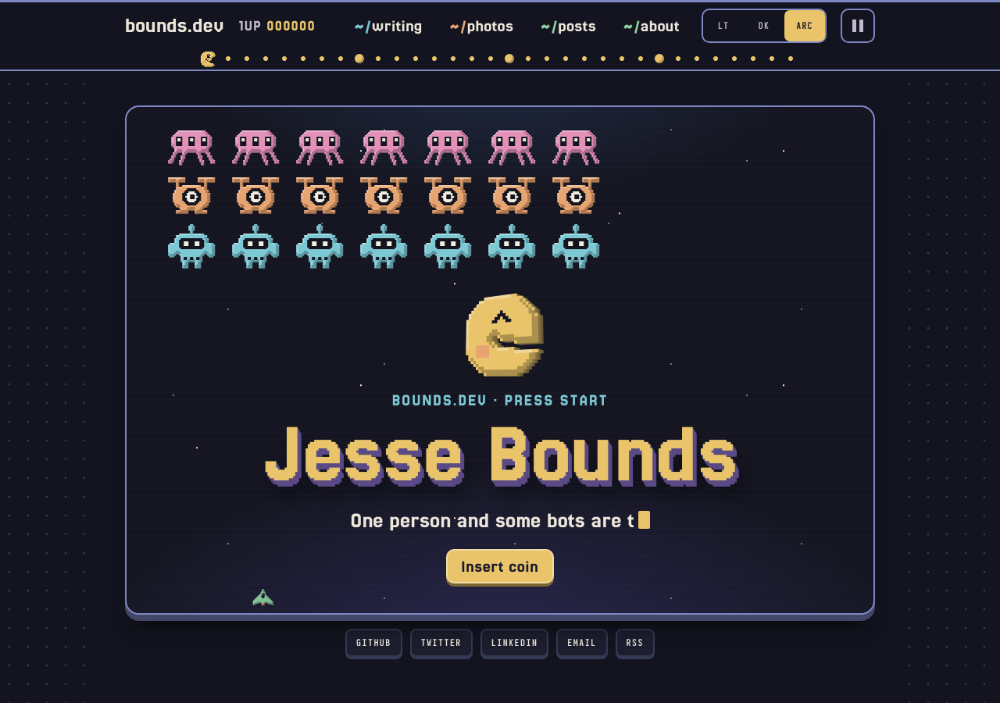 | 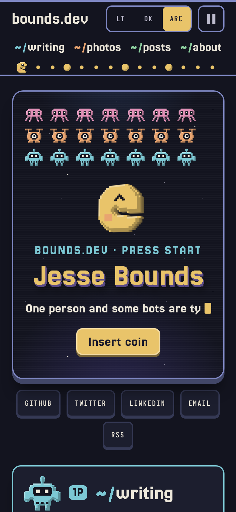 |
| Arcade, 1280 px | Arcade, 390 px |
|  | 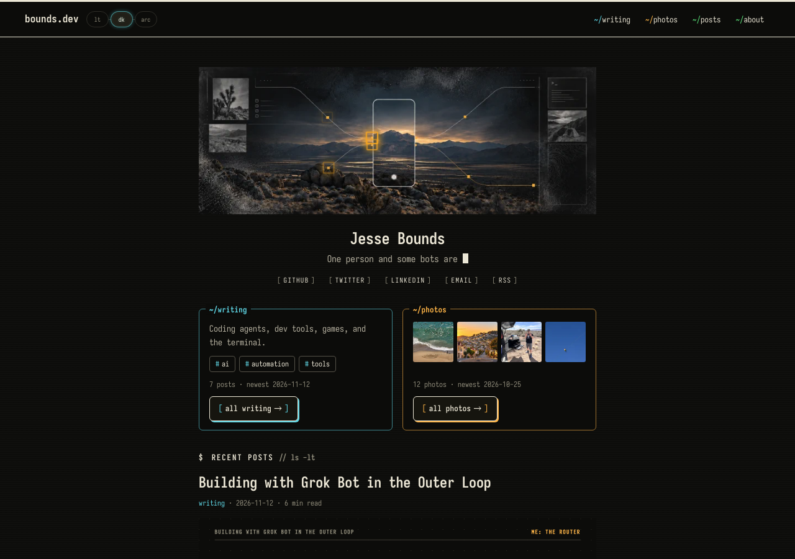 |
| Light: unchanged from production | Dark: unchanged from production |

## 1. Concept and name

**Bounds Arcade.** The site's subtitle is "One person and some bots are typing", and that is the whole game. The bots become a marching formation of pixel invaders. The blinking block cursor grows a jaw and becomes **Chomp**, who eats a row of pellets across the header as you read. The things chasing Chomp are software bugs. The site becomes an arcade cabinet as someone would build it now: a blue-black screen, butter yellow, four soft channel colors, rounded slabs with a visible edge, and a coin slot in the footer. Green and amber phosphor go away. Light and dark stay exactly as they are, and **Arcade** is a third theme a visitor can choose.

The mood is a cabinet in attract mode, remastered: the characters are still pixel art, but drawn fine, shaded, and thick enough to pick up. It waits for you to press something.

Four principles:

1. **The arcade goes around the article, never through it.** Inside a post there is one reading face, one accent color and nothing that moves or tilts on its own.
2. **Pixels for the characters, smooth for the furniture.** Sprites and display type are pixel art. Cards, buttons and lines are not: 2 px rims, rounded corners, eased motion. The first pass made everything a 4 px block, and that is what read as low resolution.
3. **Things have a side.** Every slab and sprite has thickness, and shows it when you reach for it.
4. **Play is opt-in, and the site works without it.** Games load on a button press. Paused motion, reduced motion and no-JavaScript each give a complete site (without JavaScript, the site is its light or dark theme).

All sprites are original. Nothing is copied from Taito or Namco: no sprite shapes, no logos, no sounds, no maze layouts. The invaders are robots, Chomp is a very round block cursor with a face of its own, and the chasers are beetles.

## 2. Visual system

### Color

Arcade is one dark theme. (The site's light and dark themes keep their own colors, untouched.) Every text value was measured against all three arcade surfaces; the table shows the page background and the lowest of the three. Body and UI text needs 4.5:1, borders and focus rings 3:1. The lookbook recomputes these in the browser and a headless run confirmed zero failures.

| Role | Hex | On `bg` | Lowest | Used for |
| --- | --- | --- | --- | --- |
| `bg` | `#13141F` | | | Page: a blue-black ink |
| `surface` | `#1C1E2E` | | | Cards, panels |
| `well` | `#272A3F` | | | Inline code, table stripes, pressed |
| `text` | `#ECE7DA` | 14.8 | 11.4 | Body |
| `text-2` | `#BDBBCD` | 9.7 | 7.5 | Secondary |
| `text-3` | `#A09EB8` | 7.0 | 5.4 | Meta, dates |
| `line` | `#7F88C4` | 5.4 | 4.2 | Borders, focus (dusty periwinkle) |
| `line-soft` | `#343853` | | | Decorative dividers and the dot grid only |
| `pellet` | `#E9C46A` | 11.0 | 8.4 | The accent, butter: Chomp, pellets, primary button fill |
| `cyan` | `#7CC8D4` | 9.7 | 7.4 | Writing channel |
| `orange` | `#E8A470` | 8.7 | 6.7 | Photos channel (apricot) |
| `pink` | `#E391B8` | 7.9 | 6.1 | Bot limericks channel (rose) |
| `lime` | `#8FD3A2` | 10.5 | 8.1 | Pages, success (sage) |
| `red` | `#EA8A86` | 7.4 | 5.7 | Danger, GAME OVER (coral) |

How much quieter than the first pass: in HSL terms the accents went from 82 to 100% saturation to 44 to 74% (butter 74, apricot 72, coral 70, rose 59, aqua 51, sage 44), and the border from a pure `#6C7BFF` to a periwinkle at 37%. Hue order and channel jobs did not change.

Rules that keep it honest:

- **Channel colors keep their current jobs.** Writing is cyan, photos orange, limericks pink, pages green, the same mapping the light and dark themes use. Color is never the only cue; every channel also has a text label and a sprite.
- **Edges are derived, not picked.** A slab's edge is its border color mixed halfway toward near-black with `color-mix()`; a sprite's side is its own color treated the same way. There are no extra edge tokens to keep in step.
- **Links in prose keep the text color** and carry a 2 px channel-colored underline.
- Semantic states: success is `lime`, danger is `red`, focus is a 3 px `text` outline. Selection is ink on butter.
- **The game cabinet on `/arcade/` uses these tokens in every theme.** A cabinet screen stays dark in a bright room, so under the light theme the cabinet is still dark and arcade-styled, and the page around it is the normal light site.

The second pass also drew a light "Daylight Arcade" with its own thirteen tokens. It was built, previewed and deleted in the third pass: the site's own light theme does that job.

### Typography

| Job | Font | License | Rule |
| --- | --- | --- | --- |
| Titles, headings, nav, buttons, scores and marquee words | **Jersey 25** | OFL 1.1 | 18 px and up. Regular only (it has one weight). |
| Long-form reading | **Iosevka Aile** | OFL 1.1 | Unchanged: already self-hosted, already the post face. |
| Code, dates, meta, any label under 18 px | **Iosevka** | OFL 1.1 | Unchanged. |

Why one face instead of the first pass's two: Press Start 2P is drawn on an 8-row grid, so at 24 px every stroke is a 3 px block. That coarseness was most of what made the first lookbook look low resolution, and it also forced a rule that it could only be set at 8, 16, 24, 32 or 48 px. Jersey 25 is drawn on a 25-row grid, about three times finer. It still reads as pixel lettering, it has real lowercase, and it needs no size rule: the lookbook uses it from 18 px (footer credit) to 112 px (hero title) and it stays clean throughout, including at the in-between sizes a fluid `clamp()` produces.

Cut after the first pass: **Press Start 2P** (too coarse) and **Pixelify Sans** (its bold C reads as O, and its `fi`/`fl` ligatures read as a capital A, which needed two workarounds). Both are still in the lookbook's type section, set small, so the difference is visible. Also considered now and not chosen: Jersey 20 (same family, slightly coarser, no gain) and Handjet (finer still, but thin and hard to read at heading sizes).

Self-hosting: one file next to the Iosevka ones in `themes/bounds-ascii/static/fonts/` with its `OFL-jersey-25.txt`. The Fontsource Latin file is **20.9 KB** (the first pass's two files were 20.2 KB together). It declares no Reserved Font Name, so it can be subset with FontTools the same way the Iosevka files were. `font-display: swap`, no preload: it is not needed for first paint of the reading column.

### Surfaces, edges and depth

- **The slab.** Every card and panel is one primitive: `surface` fill, a 2 px rim in the border color, a 14 px corner radius, and an edge. The edge is six stacked hard `box-shadow`s that step from the face to the back of the slab, so it reads as thickness, with one soft shadow under it. At rest the back hangs 6 px straight down. No extra markup and no images. Under `forced-colors`, a real outline replaces it.
- **The edge follows the turn.** A slab's rotation and the offset of its edge are driven by the same two numbers, so when a card tips its right side away you see its left edge, the way a real slab would show it. The angle scales with size so the edge travels a similar distance on anything: a wide card turns up to 3.5 degrees, a small tile up to 9. A soft light follows the pointer across the face.
- **Buttons are keycaps.** A 4 px edge. Hover lifts the cap 2 px and the edge grows to 6; pressing sinks it 3 px and the edge shrinks to 1.
- **Sprites are thick.** At rest a sprite carries a baked side: three hard `drop-shadow`s in its own darkened color, rasterized once. The first time one is hovered or tapped, seven silhouette copies are stacked behind the face in 3D and the sprite turns up to about 30 degrees with real sides. Only touched sprites ever get the layers.
- **What does not get depth:** the reading column. Code blocks, figures and tables inside a post use a flat slab with a 3 px edge and never tilt.
- **Scanlines** exist only on screens and never over photos or body text (the October audit already found that a page-wide overlay bands photos). They are fainter than the first pass: a 2.8% line every 3 px. They are removed whenever the page is still.
- **Dot grid** (pellets, 24 px apart) fills the page margins only. The content shell is solid.
- **The 4 px pixel unit is gone** from the furniture. Spacing stays on the site's current 4 px scale; lines are 2 px; pixels belong to sprites and type.

### Iconography

No icon font. The handful of glyphs the site needs (channel markers, lives, coin, arrows) are sprites from the same sheet, plus CSS triangles for menu arrows. Sprites are always decorative (`aria-hidden`) next to a text label.

### Sprite set

Eighteen sprites, redrawn. In the first pass each was a hand-typed character grid of about 11×10. Now each is a short list of shapes (ellipses, rounded boxes, thick lines, polygons) rasterized onto a grid of 20 to 40 pixels, which keeps curves clean and makes a sprite easy to revise: Chomp is under ten lines, and its last redraw took minutes. A second pass over the grid marks the top-left rim as highlight and the bottom-right rim as shade; those become translucent white and black overlays, so `currentColor` recoloring still works and the same sprite serves every channel color.

| Sprite | Size | Frames | Role |
| --- | --- | --- | --- |
| Typist | 30×28 | 2 | Writing invader: antenna, visor, a keyboard chest, arms that type |
| Drone | 30×24 | 2 | Photo invader: one eye, two rotors, skids |
| Crawler | 30×24 | 2 | Limerick invader: three eyes like keys, too many legs |
| Caret | 26×22 | 1 | The player's ship |
| The Deadline | 40×18 | 1 | Mystery saucer that crosses the top |
| Chomp | 28×28 | 2 | The hungry, happy block cursor: a squircle, a big eye with a glint, a blush, an upturned mouth. Frame 2 closes the mouth and squints the eye |
| Bug | 28×28 | 2 | Chasers, in four colors: Heisenbug, Off-By-One, Null, Race. A fifth "Fixed" color after a power pellet |
| Pellet, power pellet | 6×6, 12×12 | 1 | Progress and bonuses |
| Coffee, floppy, rubber duck, cherries | about 26×26 | 1 | Fruit-style bonus items |
| Camera | 30×24 | 1 | Photos glyph |
| Heart, coin, star, puff | up to 24×24 | 1 or 2 | Lives, the footer slot, the star field, a zapped bot |

**About Chomp.** The first Chomp was a 10×11 square with a two-pixel eye and two feet, and it looked dim. The second was a rounded block with a stern brow: better drawn, but not much fun. The current one is round and pleased with itself: the corner radius is 10.5 of a 13 px half-width, so it reads as round while its top, bottom and back stay slightly flat; it has a big eye with a glint, an apricot blush, and a mouth whose corner turns up. Open-mouthed it beams, and mid-chew the eye shuts in a happy arc, so the two-frame cycle reads as chomp, grin, chomp, grin. It is still not a perfect circle, on purpose. See the trademark note in section 9.

Size: the whole set as one SVG symbol sheet is **34.1 KB, 5.8 KB gzipped**, including the one-path silhouettes the depth layers use (about 26 KB and 5.2 KB without them). That is more than the first pass's 9.4 KB of flat sprites, which is the cost of the resolution. An instance on the page is two `<use>` elements.

As built, the shape lists live in one small script (`scripts/sprites.mjs`, no dependencies) that writes `themes/bounds-ascii/assets/sprites.svg` and a JSON copy of the rectangles for the canvas games. The output is committed, like the GIF-hero WebPs, so the Pages build needs nothing new; `make check` fails when it is stale. The arcade script places sprites as `<use href="…/sprites.<hash>.svg#spr-typist-0">`, so the sheet is fetched once, cached, and never requested in light or dark. Variable-driven paints are written as `style="fill:var(--…)"` so they resolve through an external `<use>`; that has been checked in Chromium and still needs a look in Safari.

## 3. Component by component

This table describes the **arcade theme only**. Under light and dark every component is production's, unchanged; the "Today" column is what those two themes still show.

| Component | Today | Bounds Arcade |
| --- | --- | --- |
| **Header** | Sticky bar: brand, four-pill theme control, `~/` nav, 3 px progress bar | A HUD. Brand left, `1UP 000000` score (decorative), nav in Jersey 25, then the three-way theme control and a small pause button. A 3 px periwinkle top rule. On phones: brand and controls on row one, four nav tabs on row two. |
| **Current page** | Bold plus a 2 px underline | A menu-select arrow before the item, a 3 px channel-colored underline, and `aria-current`. The arrow blinks five times and then holds still. |
| **Marquee** | None | The *cabinet marquee* is the butter title strip above the arcade cabinet, and "INSERT COIN" is the hero's primary button. I do not propose scrolling the nav itself: nav that moves is hard to hit. |
| **Reading progress** | 3 px bar | A centered track of pellets in a dark strip along the header's bottom edge: about 60% of the page wide (86% on a 390 px phone, capped at 960 px on very wide screens), and always a whole number of pellets. Chomp crosses it as the page scrolls and eats each pellet as his mouth reaches it; scrolling back brings them back. Power pellets sit on the pellets nearest 25, 50 and 75% and pop when eaten. It follows the page's own scroll on every page: empty at the very top, eaten clean at the very bottom. Production's `--read` variable and `read_progress` events on posts are untouched and not used by the track. |
| **Home hero** | Field Signal art | A screen: star field, a formation of bots (three rows, one per channel) marching in steps, a large Chomp that rocks slowly in depth and turns to follow the pointer, the Caret ship patrolling, the name as an extruded title, the subtitle with the typing cursor, and an INSERT COIN button that goes to the arcade page. Field Signal stays the hero in light and dark. |
| **Home doors** | Two titled panels | Two cabinet slabs, "1P ~/writing" and "2P ~/photos", with counts as score counters; they tilt under the pointer. Same links, same photo strip, same rule that the newest post appears once. |
| **Newest post** | Unboxed featured entry | Same entry on a slab that tilts under the pointer. Its hero sits in a dark bezel with a "NOW PLAYING" strip. The image itself is untouched. |
| **Post lists** | `ls -lt` rows: glyph, date, read time, title | A high-score table. Rank numbers come from a CSS counter (decorative), then date, read time, title, and the channel's sprite. Hover or focus shows the select arrow and a tint; the sprite hops once. `~/writing` entries and `~/photos` contact sheets keep their layouts and sit on slabs. |
| **Post page** | Mono title with `$`, Aile body, 66ch | Title in Jersey 25 (36 to 44 px; it is condensed, so it runs about a fifth larger than the first pass's sizes for the same line length), byline in Iosevka caps, hero in a bezel, then the reading column exactly as now: Iosevka Aile, 66 characters, plain background. **No ambient motion and no tilt inside `.post-content`.** |
| **Headings** | Aile bold | `h2` in Jersey 25 36 px with a small channel-colored square before it; `h3` Jersey 25 28 px; `h4` stays Aile caps. |
| **Code blocks** | Panel with language and copy | Flat slab (3 px edge, no tilt), Iosevka label bar, copy button that answers "Copied +10". Optional: five-color syntax tokens from the palette (today's code is monochrome; say if you want to keep it that way). |
| **Quotes** | Left rule, italic | Surface panel with a 4 px left border in the channel color and rounded right corners. |
| **Tables** | Hairline grid | 2 px outer border with rounded corners, uppercase Iosevka header in the channel color, striped rows. The EXIF table on photo posts keeps its mono face. |
| **Figures** | Image and caption | Flat slab, caption below a soft rule. `post-illustration` and `<picture>` art keep their sizes. |
| **Lightbox** | Native `<dialog>` | Same dialog, same keyboard and focus handling, reskinned: slab, counter in Jersey 25 ("03/14"), keycap buttons. Photos are never scanlined or tinted. |
| **Charts** | Hand-made SVGs in post bundles | Published as they are, framed like any figure. |
| **GIF heroes** | `<picture>`: still for reduced motion, WebP, GIF | Unchanged markup and order. The bezel is CSS around the `<figure>`. |
| **Tags** | Text chips | Rounded chips with a channel-colored dot; they lift 2 px on hover. Same links. |
| **Footer** | Status bar of links | The **chase lane** runs along its top edge. Below it the same links, plus a coin slot that links to `/arcade/` and shows `CREDIT 00`. |
| **404** | `cd: No such file` joke | **GAME OVER / CONTINUE?** with a 9-second countdown, the missing path in code, and the same three links ("Continue: home", `~/writing`, `~/photos`). A tiny game is optional (section 5). |
| **Photo pages** | Contact sheet, photo hero, EXIF, map | Layouts unchanged. Thumbnails get a 2 px rounded frame that turns apricot on hover, the hero gets a bezel without scanlines, the map keeps its light and dark Mapbox styles. |
| **About** | Portrait hero, social links | Production's structure with the arcade skin. |

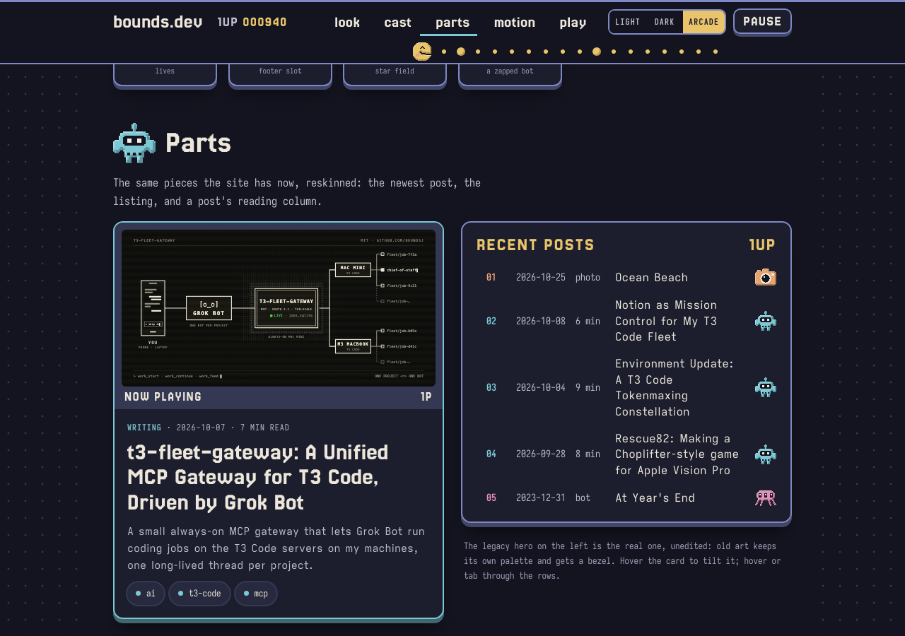

The hero in that card is the real `t3-fleet-gateway-hero.svg`, unedited, in its original green-on-black.

### The theme control

The four-pill `lt / dk / grn / amb` control becomes a three-option control: **light, dark, arcade**. It is the same control in the same place with the same semantics, with two options removed and one added, and it is the only theme setting on the site.

- **Default.** With no saved choice the site follows `prefers-color-scheme`, live, exactly as production does. It never picks arcade for anyone: arcade is something a visitor chooses.
- **Storage and migration.** The choice stays in `localStorage["bounds-crt"]` as `light`, `dark` or `arcade`. Saved `green`, `amber` and `crt` migrate to `dark`, and `paper` to `light`. The inline pre-paint script applies it, so there is no flash.
- **Analytics.** `data-theme` on `<html>` keeps its meaning. `site_theme` and `theme_change` report `light`, `dark` or `arcade`; no new events.
- **No motion switch.** Arcade's motion is automatic. It is still when the system asks for reduced motion, more contrast, or forced colors. For everyone else there is one small pause button in the arcade header ("Pause animations", a real button with `aria-pressed`, remembered in `localStorage["bounds-motion"]`). It exists because arcade has motion that starts on its own, runs longer than five seconds and sits beside other content (the formation, the mascot, the stars, the footer chase lane), and WCAG 2.2.2 requires a way to stop that. It is not offered in light or dark, which have nothing to pause.
- **Without JavaScript** the site is its light or dark theme, following the system, as on production. Arcade needs JavaScript.

The second pass proposed two switches, NIGHT/DAY and FX/CALM. Both were built and then removed: with arcade as one theme beside light and dark, a second color mode and a separate effects setting were two settings too many.

## 4. Motion design

**The language.** Two kinds of movement, on purpose. **Sprites move like sprites:** two-frame cycles swapped in steps, a formation that marches in steps. **Everything else moves like an object:** it eases, it settles with a small overshoot (`cubic-bezier(.2, 1.45, .4, 1)`), and it turns in depth under the pointer. The first pass stepped everything, including buttons and reveals, and that was part of what made it feel coarse. Durations stay short: 60 to 180 ms for a press, about 500 ms to settle after a tilt, up to 900 ms for a set piece that plays once. Ambient loops are slow, pause when off screen, and stop when motion is paused or reduced. Nothing blinks or swaps frames faster than 2.5 times a second, and no blink covers more than a sprite-sized area.

What animates: `transform`, `opacity` and the separate `translate` property, with two exceptions. The slab under the pointer animates its `box-shadow` (that is its edge), and the hero title animates its `text-shadow` (that is its side). Both repaint one element while the pointer is on it and nothing otherwise.

**Seven wow moments:** (1) the marching bot formation, (2) Chomp eating the reading-progress pellets, (3) things turning to show their side, (4) the chase lane in the footer, (5) the CRT power-on, (6) the level-start wipe between pages, (7) dropping a coin and getting a game.

| # | Animation | Where | Trigger | Duration and timing | How | Reduced motion, or paused | Cost |
| --- | --- | --- | --- | --- | --- | --- | --- |
| 1 | **Bot formation march** | Home hero | Page load; pauses off screen; parks after two passes until hovered or focused | 26 s per pass: 10 steps across, a 12 px drop, 10 steps back | CSS keyframes on one container, `translate` with `steps(10)`. Width from container units, no JS | Formation centered and still | One composited layer |
| 2 | **Sprite walk cycles** | Formation, chase lane, Chomp | With their parent | 2 frames, 0.4 to 1.3 s per cycle | Prototype toggles `visibility` per frame, which re-styles on the main thread every frame. **Production: two stacked layers per group (frame A, frame B) swapped with `opacity` and `step-end`**, which runs on the compositor | Frame A only | Prototype: measured 3.8% of one core while the hero is on screen (190 ms of task time in 5 s). Production target: about zero |
| 3 | **Slab tilt** | Cards, cabinet doors, sprite tiles, the newest-post card. Never the reading column | Pointer over the slab (fine pointers only) | Follows the pointer with a 120 ms lag; settles in 520 ms with overshoot when the pointer leaves | One delegated `pointermove`, one `requestAnimationFrame` per frame, six custom properties written on the hovered element only. CSS turns them into `rotateX/Y`, the edge offset and a light on the face | No tilt, no light; hover is a color change | One element repaints its shadow while hovered. Nothing runs when the pointer is still |
| 4 | **Sprite turn** | Any sprite marked as having depth: hero mascot, cast, section icons | Pointer over it or its tile; one tap on touch (a 1.3 s turn left, right and back) | Up to about 30 degrees; same lag and settle as the slab | Seven silhouette copies are added behind the face on first touch, each `translateZ`'d, inside a `preserve-3d` wrapper. Before that the side is a baked `drop-shadow` | Still sprite with its baked side | Seven small compositor layers per touched sprite, built once. The hero mascot is the only one built at load |
| 5 | **Title side** | Home hero title, GAME OVER | Pointer anywhere over the hero | 260 ms ease | Eight stacked `text-shadow`s whose offset is two custom properties | Fixed side, down and right | One text repaint per pointer frame |
| 6 | **Mascot rock** | Home hero | Load; pauses off screen; the pointer takes over while it is on the hero | 6.5 s each way, ease-in-out | One `rotateX/Y` keyframe pair on the layered Chomp | Still, facing forward | Compositor only |
| 7 | **Star field parallax** | Hero and game screens | Load; pauses off screen | Three layers drifting at 50, 90 and 150 s per 600 px, linear | Stars are `box-shadow`s on three 1 to 2 px elements; one `translateY` each | Stars visible, not moving | Three layers, no script |
| 8 | **Chomp progress track** | Header, every arcade page | Scroll | Follows scroll directly, with no easing. Chomp chews (0.4 s cycle) only while the page is scrolling and for about 0.2 s after, and faces the way you scroll. A power pellet pops once when eaten (300 ms scale and fade), never two within 350 ms, and not when un-eaten | One number, the scroll fraction, drives two transforms: `translate3d` on Chomp and `scaleX` on the cover that hides eaten pellets, snapped to whole pellets so none is ever cut in half. The number comes from a passive, rAF-throttled scroll listener that exists only in arcade (production's `--read` measures the article and is already past zero at the top of a post, so the track does not use it). Sizes are measured on load and resize, never per frame | Chomp still tracks and pellets still disappear (it is information), without chewing or pops | Two transforms per scroll frame |
| 9 | **Score counter** | Header HUD; door counts | Scroll (HUD); entering view (counts) | Counts tick over 700 ms, ease-out | HUD is text set in the same scroll handler. Counts use one `requestAnimationFrame` loop each, once, via IntersectionObserver. Final value is in the HTML | Final value at once | Negligible |
| 10 | **Level-start wipe** | Between pages | Same-site navigation | 240 ms on real navigations: six bars close in steps and open the other way. "READY!" shows only on the first navigation of a session | Cross-document View Transitions (`@view-transition { navigation: auto }`) with a stepped `clip-path` on the old and new snapshots. Browsers without it just load the page | No transition | Browser-native, off the main thread |
| 11 | **CRT power-on** | Home hero screen | First home view per session (the existing `kc-intro` session gate) | 620 ms once, ease-out: a bright line, then the picture opens | CSS keyframes: `transform: scale` plus `filter: brightness` on the screen only, not the page | Skipped | One short paint-heavy animation. Scoped to the hero so it cannot delay text paint; LCP not yet measured |
| 12 | **Chase lane** | Footer top edge | Footer in view | 18 s loop, linear travel | One strip `translateX`; bug color and Chomp facing flip with `step-end` | A still row: bugs, then Chomp | One layer |
| 13 | **Coin drop** | Footer coin slot, arcade page | Click or Enter | 640 ms: the coin tips, falls with gravity, then the credit ticks | CSS keyframes; one class toggle | Credit changes at once | Negligible |
| 14 | **Keycap press** | Every button | Hover, press | Lift 180 ms with overshoot; press 60 ms | CSS `:hover` and `:active`: `translateY` and the edge height | Instant state change, no lift | None |
| 15 | **Row and card hover** | Lists, cards, tags | Hover or keyboard focus | Select arrow instant; title underline draws over 320 ms; the row's sprite hops once (520 ms); tags lift 2 px | CSS only | Instant state change, no hop | None |
| 16 | **Scroll reveal** | Cards, doors, sprite tiles. Never body text | Entering view, once | 16 px up and in: fade 320 ms, travel 520 ms with overshoot | IntersectionObserver adds a class. Uses the separate `translate` property so it cannot fight a tilt. The hidden start state exists only while motion is on and the script has opted the element in | Everything visible from the start | One observer |
| 17 | **Cheat-code bug storm** | Any page | The old cheat code | 2.6 s, 22 sprites tumble down | DOM nodes created on demand and cleared after | A toast only | Brief |
| 18 | **Theme switch** | Header | Choosing light, dark or arcade | Production's circular wipe, in every theme; arcade's two files are fetched first if they are not loaded yet | A class and attribute change inside the existing wipe | Instant swap | None |

**Touch and keyboard.** Tilt is a pointer effect, so a phone gets less of it by nature. What a phone does get: the baked sides and edges everywhere, the rocking mascot, keycaps that sink under a thumb, and a tap on any cast sprite that turns it once. Keyboard focus gets the same color and arrow states as hover; it does not tilt anything, because a focus ring on a rotated card is harder to read than one on a flat card.

Guardrails: no animation libraries; one scroll listener (the one that exists), one `pointermove` listener for tilt and one `pointerdown` listener for tap-to-turn; no layout properties animated; ambient loops get `animation-play-state: paused` when their section leaves the viewport and when the tab is hidden; depth layers are built only for sprites someone touches; and the reading column has no motion at all.

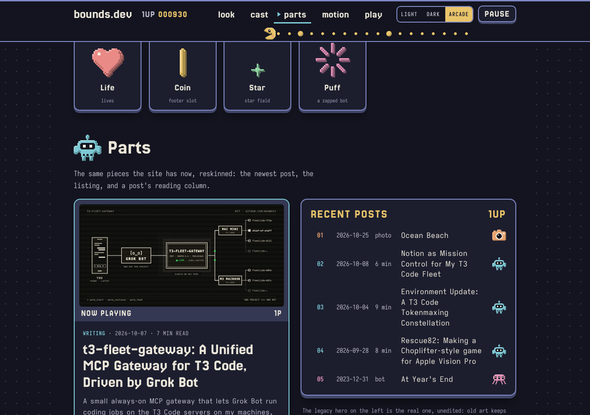

| | |
| --- | --- |
| 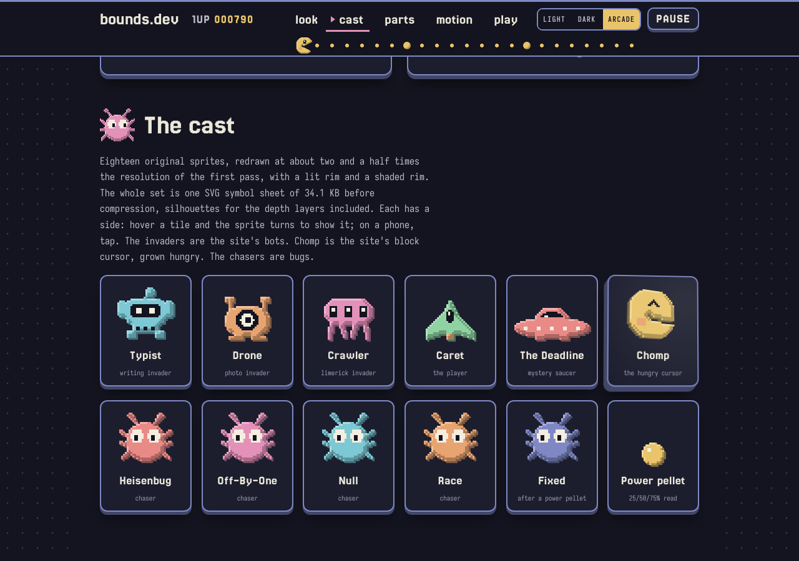 | 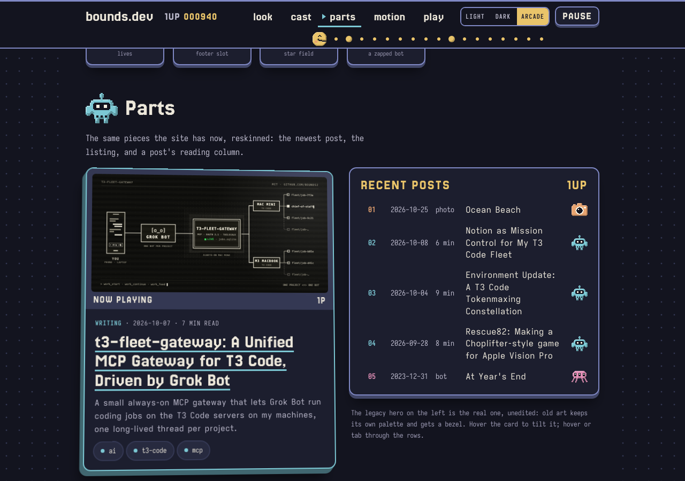 |
| Pointer on the Chomp tile (top right): tile and sprite both turn | Pointer on the card's top right corner: the opposite edges show |

## 5. Mini games

All games: vanilla JS, one file each, fetched only when the visitor presses a button, keyboard and touch, pause on blur, tab switch and scroll-away, high score in `localStorage`, no network, no sound until asked. With JavaScript off, each game's place shows a still screen and a sentence, and every link around it works.

### (a) Bounds Invaders: build first

- **Where:** a new `/arcade/` page. It works in every theme, and its cabinet is dark and arcade-styled in all of them. The footer coin slot and the home hero button that lead to it exist only in the arcade theme. Not on post pages.
- **Rules:** Bots march and drop; shoot them before they reach you. Three lives, waves get faster, the Deadline saucer is worth a bonus. Every bot is a real post: zapping one adds its title to a feed under the cabinet, as a link. It is a strange and effective way to browse the archive.
- **Controls:** arrows or A/D to move, Space to fire, P to pause, Esc to pause and give the keyboard back to the page. Touch: three large buttons (left, right, fire, 64 px tall), or drag on the screen to steer and tap to fire.
- **Size:** about 4.6 KB gzipped as built, with the saucer. It reads sprite rectangles from the shared sheet data, paints each sprite once to an offscreen canvas, and blits.
- **Accessibility:** the canvas has a label and a visible focus ring; a polite live region announces waves, hits and game over (not every point); arrow keys and Space are captured only while the game has focus and is running; the only blink is the ship after a hit, 2.5 Hz for 1.4 s. The screen is a 400×520 grid (twice the first pass's 200×260) whose backing store is a whole multiple of that grid, at least as dense as the display.
- **Post data:** Hugo writes the 30 newest titles and URLs per channel into a small JSON island on `/arcade/` only.

A minimal version is playable in the lookbook. A headless run confirmed: script not requested before the first coin, keyboard play, P and Esc, pause on blur and scroll-away, game over, high score saved, touch buttons on a 390 px phone profile.

### (b) Pellet reading: build first (it is the progress bar)

- **Where:** the header of every page in the arcade theme. It shows how far down the page you are, from the very top to the very bottom. A page that cannot scroll shows Chomp at the start with every pellet intact.
- **Rules:** scrolling moves Chomp along the track and he eats what he reaches; scrolling back un-eats it, so the row always shows exactly where you are. On posts, each power pellet eaten adds 500 to the HUD score. (The proposal's "CLEAR!" marker and a cherry on finished posts were not built.)
- **Controls:** scrolling. **Size:** about 0.6 KB in the main bundle.
- **Accessibility:** the bar is `aria-hidden`. Nothing is sent anywhere, and "clear my scores" lives on `/arcade/`.

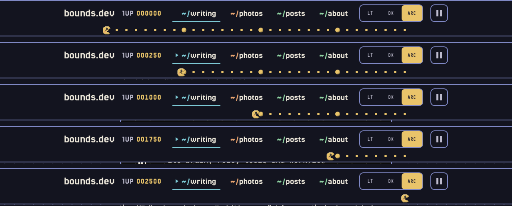

The track on a long post at 0, 25, 50, 75 and 100% scroll, 1280 px. It is 768 px wide there (60% of the page), centered. Below: 390 px at 0, 50 and 100%, where it is 336 px (86%).

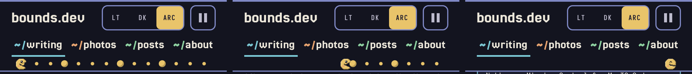

### (c) 404 Bug Squash: build second

- **Where:** the arcade theme's 404 page, under GAME OVER, behind a "CONTINUE?" button. Light and dark keep production's 404, with no game.
- **Rules:** ten seconds. Bugs crawl out of the broken path. Squash five to "fix" it and win a link home with a flourish. Lose and you get the same link.
- **Controls:** the bugs are real `<button>`s, so click, tap, or Tab and Enter all work. **Size:** about 1.3 KB gzipped.
- **Accessibility:** no time pressure is required to use the page; the three links are above the game and always visible. With motion paused or reduced the bugs do not move.

### (d) The cheat code: build, it is nearly free

- **Where:** everywhere in the arcade theme, hidden. Up, up, down, down, left, right, left, right, B, A.
- **Rules:** a bug storm, a toast, and 30 lives in Bounds Invaders. **Size:** 0.3 KB in the main bundle. Keyboard only.

### (e) Chomp: not built

- **Where:** a second cabinet on `/arcade/`.
- **Rules:** a 15×15 original maze. Eat every pellet; four bugs hunt you, each differently (Heisenbug heads straight for you, Off-By-One aims one tile ahead, Null wanders, Race is fast on straights). Coffee makes them "Fixed" for six seconds.
- **Controls:** arrows or WASD; swipe or an on-screen d-pad. **Size:** about 7 KB gzipped.
- **Why it might be cut:** it is the largest, needs the most tuning to feel good, and a maze game is the one place where "evokes" can drift toward "resembles". If it is built, the maze, the characters and the sounds must stay visibly our own.

**Built:** (a), (b), (c) and (d). **Not built:** (e). Cut for good: leaderboards (no backend), music, and any game on a post page.

## 6. What stays the same

| Feature | How it survives |
| --- | --- |
| Posts, URLs, taxonomies, pagination | No content, front matter, permalink or config changes. Templates keep their structure; changes are class names, wrappers and sprites. One new page, `/arcade/`. |
| Home rule: newest post appears once, with its hero | Same partials and selection logic. The contract test reads the first heading that links to a post, so no new post-linking heading may be placed above it on home or `/posts/`. |
| `~/writing`, `~/photos`, `/posts/`, tags, categories | Same lists, reskinned. |
| Search | The site has none today. Nothing to carry over. |
| RSS (`index.xml`) | Untouched templates. Expect byte-identical feeds; verify with `compare-site-builds.py`. |
| Social metadata, canonical, JSON-LD | `layouts/partials/head.html` logic unchanged. The card padding color stays `#14130F` on purpose (section 7). |
| GIF heroes with reduced-motion stills | Same `<picture>` and source order; `test_animated_heroes_have_native_reduced_motion_stills` keeps passing. `gif-heroes.py` and its lock file are not touched. |
| Figure lightbox | Same `<dialog>`, focus trap, keyboard, counter and `photo_open` events. CSS only. |
| Charts and post SVGs | Published as they are. |
| Photo pages, EXIF tables, Mapbox | Same markup; the map still switches between its light and dark styles with the mode. |
| Dither option | `dither.js` unchanged. |
| Light and dark | Unchanged from production, pixel for pixel apart from the theme control. They still follow the system until a choice is saved, and are applied before paint. |
| Reduced motion | Light and dark behave as on production. Arcade is still under reduced motion, more contrast and forced colors, and has a pause button for everyone else. |
| Analytics | Same events and `content_group`. `site_theme` reports `light` or `dark`. Dev mode and the host guard are unchanged. |
| Post checks, `make check`, `make test`, Pages workflow | No changes to checks. `make check` passes on this branch with the proposal files added. |
| Performance posture | Static, no framework, one deferred bundle, lazy Mapbox, lazy games. |
| Photo poster tool | Not touched. |

## 7. Art and asset migration

What I found, which differs a little from the brief:

- **One post has generated art.** `posts/building-with-grok-bot` (merged to main on 2026-11-15, after the first pass of this proposal was written) is drawn by `scripts/post-art/building-with-grok-bot/`, whose `lib.py` holds its palette (`#38E25B` green and `#FFB547` amber on `#0C0C0A`). Every other post's art is hand-made SVG and raster files committed in its bundle. `scripts/gif-heroes.py` converts GIF heroes to WebP and records hashes in `scripts/gif-heroes.lock`.
- **Two posts use the phosphor palette in their art:** `building-with-grok-bot` (two GIF heroes, diagrams, chart, social card) and `t3-fleet-gateway` (hero SVG and `social-card.svg`/`.png`, `#38E25B` on `#0C0C0A`). The generated one could be re-skinned later by editing its palette and rebuilding, at the cost of new GIFs, WebPs, lock entries and a new social card; that is still not recommended now. The other writing posts have their own palettes (slate blue and teal diagrams, Notion-style mocks).
- **Green and amber live in few places:** `main.css` (`--phosphor-green/amber`, `.crt--green`, `.crt--amber`, two pill-glow rules), `theme-init.js` (the mode list and two class toggles), `header.html` (the pill), `docs/analytics.md` (the `site_theme` values), and `assets/css/field-signal.css` (the amber `#F5A623` scan line and nodes on the home art). There is no `<meta name="theme-color">`; `site.webmanifest` says `#ffffff`.

**Recommendation: leave every published post's art alone, and frame it.** The bezel treatment makes old art look like a cartridge from another system, which suits it. Recolor nothing inside post bundles.

Why not recolor and regenerate:

- The three GIF heroes are pinned by SHA-256 in `gif-heroes.lock`. Any re-render changes the GIF, the WebP and the lock, and `make check` fails until all three are recommitted. Lossy WebP output is also not guaranteed byte-identical across libwebp versions.
- Social cards are fetched and cached by other sites. If `head.html`'s padding color changed from `#14130F` to the new ink, every auto-generated card would get new bytes and a new hashed URL; old shares would point at files that no longer exist. Keep `#14130F`.
- Recoloring hand-made SVGs is manual work per file with no test to catch a mistake, for posts whose art was designed as a whole.

Site-level art that was considered and left for later (none of this is done):

| Asset | Change | Effort |
| --- | --- | --- |
| Favicons, `apple-touch-icon`, Android icons, `jb-logo.png` | New pixel mark (Chomp, or a bot) on ink, exported at 16/32/180/192/512 | 0.5 day |
| `site.webmanifest`, `<meta name="theme-color">` | `#13141F` (and `#F5EFE1` for light via `media`) | Minutes |
| `static/social-default.png` | New 1200×627 site card in the arcade look. Same filename, so the URL is stable; caches refresh on their own schedule | 0.5 day |
| Field Signal home art and `field-signal.css` | Unchanged: it is the home hero in light and dark. Arcade hides it and shows the formation | None |
| New posts from here on | Use the arcade palette if they want to; the post checks do not care | None |

Optional, not recommended now: a one-off arcade re-skin of the `t3-fleet-gateway` hero and card (about half a day, and its card URL would have to keep the same filename).

Byte-identical output, as measured: against a production build, every image, feed and generated social card is identical, and `sitemap.xml` gains only `/arcade/`. The HTML differs only by the inline script, the stylesheet link, the bundle hash and the theme control (`scripts/compare-site-builds.py`).

## 8. How it is built

### The rule

Light and dark are production's templates, stylesheet and scripts with the smallest possible edits: green and amber removed, the control made three-way, and a loader for arcade. Arcade is a separate layer that is fetched and applied only when chosen, and removed completely when the visitor switches away.

### Loading and gating

- **Pre-paint.** The inline script in `<head>` (`theme-init.js`) reads `bounds-crt`, migrates old values and sets `data-theme`. For a saved arcade choice it also writes the arcade stylesheet and a deferred arcade script into the document before first paint, and keeps the body hidden until the arcade pieces are in place, so the first visible frame is already arcade. There is a 3-second safety timeout, and if the arcade stylesheet fails to load the page falls back to dark and keeps the saved choice.
- **One stylesheet at a time.** While arcade applies, the site's `main.css` is disabled and `arcade.css` replaces it. Arcade's CSS was designed as a complete look, so layering it over `main.css` would have meant undoing production rule by rule and risking leaks in both directions. Every arcade rule is still scoped under `:root[data-theme="arcade"]`.
- **Arcade-only markup is made by script.** `arcade-skin.js` builds the HUD score, pause button, Chomp strip, hero, bezels, high-score chrome, chase lane, coin slot and the GAME OVER panel on top of production's markup, and records every change so switching away undoes it. Production's own headings and links are moved or relabelled, never duplicated, so there is one `<h1>` and one set of post links in every theme.
- **Light and dark HTML carries no arcade content:** no sprites, no arcade stylesheet or script tags, no Jersey 25. The only additions are the asset URLs inside the inline script and an `id` on the main stylesheet link.
- **Switching at runtime.** Choosing arcade fetches its two files the first time and switches inside production's existing circle wipe. Switching back removes everything arcade added.
- **Motion state** is `data-motion` on `<html>`: `on` or `still`. It is `still` under reduced motion, more contrast or forced colors, or when the pause button has been pressed. The cross-document page wipe (`@view-transition`) exists only inside `arcade.css`, so light and dark navigations never opt in, and it is skipped when motion is still.
- **`/arcade/`** loads a small cabinet stylesheet in every theme, scoped to the cabinet, so the game is dark and arcade-styled wherever you come from. The game loader is bundled on that page and inside the arcade script (for the arcade 404).

### Footprint (gzipped, measured against a production build)

| | Production | Now, light and dark | Arcade adds, only when chosen |
| --- | --- | --- | --- |
| Main CSS | 8.3 KB | 8.1 KB | `arcade.css` about 12.5 KB (replaces the main CSS) |
| Main JS bundle | 6.2 KB | 6.6 KB | `arcade.js` 7.8 KB |
| Home HTML | 6.1 KB | 6.7 KB | |
| Font | | none | Jersey 25, 20.9 KB |
| Sprites | | none | one cached sheet, 5.9 KB |
| Games | | none | Bounds Invaders about 4.6 KB and Bug Squash about 1.3 KB, each fetched on a button press; cabinet CSS 2.5 KB on `/arcade/` |

Light and dark pay about 1 KB per page for the three-way control and the loader, and nothing else.

### Files

| File | Role |
| --- | --- |
| `themes/bounds-ascii/assets/css/main.css` | Production's stylesheet minus green and amber. |
| `themes/bounds-ascii/assets/css/arcade.css` | The whole arcade look: tokens, slabs, HUD, lists, prose, motion, still-state rules. Loaded only for arcade. |
| `themes/bounds-ascii/assets/css/arcade-cabinet.css` | The game cabinet, loaded on `/arcade/` in every theme. |
| `themes/bounds-ascii/assets/js/theme-init.js` | Inline pre-paint: three themes, migration, arcade preload, motion state. |
| `themes/bounds-ascii/assets/js/theme.js` | The three-way control, the arcade loader, following the system when nothing is saved. |
| `themes/bounds-ascii/assets/js/arcade-skin.js`, `fx.js` | Arcade's markup and its motion (reveals, counters, formation parking, tilt, tap-to-turn, depth layers). Bundled into `js/arcade.js`. |
| `themes/bounds-ascii/assets/js/games.js`, `games/invaders.js`, `games/squash.js` | The lazy game loader and the two games. |
| `themes/bounds-ascii/layouts/partials/arcade-assets.html`, `sprite.html`, `sprite-sheet.html` | Build the arcade bundle and expose its URLs. |
| `scripts/sprites.mjs`, `themes/bounds-ascii/assets/sprites.svg`, `sprites.json` | The sprite shapes and their generated, committed sheet (`make sprites`). `make check` fails when the sheet is stale; the Pages workflow regenerates and flags it. |
| `content/arcade/_index.md`, `themes/bounds-ascii/layouts/arcade/list.html` | The `/arcade/` page: a section page with no feed, outside `content/posts/`. |
| `themes/bounds-ascii/static/fonts/jersey-25-latin-400.woff2` and its OFL text | The display face. |
| `themes/LoveIt/` | Not touched. |

### Tests

- **Contracts** (`make test`): every page offers the light/dark/arcade control; light and dark pages never link arcade files or contain sprites; no page loads a game through `<script src>`; `/arcade/` is not a post and is in no feed; the sprite sheet is fresh and every referenced sprite id exists. No existing assertion was loosened.
- **Production parity:** light and dark were compared with a production build, full page, pixel by pixel, at 1280 and 390 px on ten pages, saved and unsaved. The only difference is the theme control itself.
- **Byte comparison** (`scripts/compare-site-builds.py`): every feed and image is identical; `sitemap.xml` gains exactly `/arcade/`; the HTML differs only in the inline script, the stylesheet link, the bundle hash and the theme control.
- **Screenshots stay a review artifact**, not a test, as AGENTS.md asks.

## 9. Risks, and the decisions as made

Risks that remain:

- **Untested browsers.** Everything was checked in headless Chromium. Safari, Firefox and real phones have not been tried, and three things are worth a look there: sprites drawn through external SVG `<use>` with CSS variables, the pre-paint arcade load, and the touch controls on `/arcade/`.
- **Trademark proximity.** The genre is free; specific characters are not. Chomp is very round, butter yellow, and has a wedge mouth, so at a glance it is in the famous one's family. What keeps it ours: it is a squircle and not a circle, it has a face (an eye with a glint, a blush, a smile, a squint when it chews) where the original has none, and it is named and framed as the site's cursor. That is a judgment call, not a legal opinion. The cheapest way to add distance is color. Keep the robot invaders and the beetle chasers as they are.
- **Arcade is rebuilt by script on every page load.** That keeps light and dark clean, and it means a script error in the arcade bundle would leave an arcade visitor on the dark fallback. The safety timeout and fallback exist for that; they need to stay.
- **Two stylesheets to keep in step.** A new component added to the site needs a rule in `main.css` and, if arcade should style it differently, one in `arcade.css`. Unstyled-in-arcade is the failure to watch for when adding features.
- **Depth cost.** Each turned sprite is eight compositor layers. Layers are built only for sprites a visitor touches; low-end phones still deserve a real-device check.
- **Animated GIF heroes ignore the pause button.** They switch to their still frame only through the system's reduced-motion setting, as on production.
- **Motion fatigue.** The formation parks after two passes, and the pause button is one tap away.

Decisions, as made:

1. **Themes:** light, dark and arcade. Light and dark unchanged from production. Green and amber removed. *(Jesse, third pass.)*
2. **Settings:** one three-way theme control. No NIGHT/DAY, no FX/CALM. *(Jesse, third pass.)* A single pause button in the arcade header, because WCAG 2.2.2 needs one.
3. **Default:** follow the system between light and dark; never default to arcade.
4. **Sound:** opt-in inside games only, off by default.
5. **Old post art:** framed in arcade, left alone everywhere.
6. **Games:** `/arcade/` (Bounds Invaders) works in every theme with a dark cabinet. The 404 in light and dark is production's original; GAME OVER and Bug Squash are arcade-only, as are the footer coin slot, the hero's "Insert coin" and the cheat code. The Chomp maze game is not built.
7. **Home hero:** Field Signal stays on home in light and dark. In arcade the marching formation replaces it. About is unchanged.
8. **Not done:** favicons, the web manifest and the site social card are untouched. Code blocks stay monochrome. Finished posts do not get a cherry.

Still Jesse's to weigh: whether Chomp's likeness is comfortable.

## Appendix: the lookbook and the screenshots

`docs/proposals/arcade-theme-preview/` is the design prototype: a static page with no build step and no network requests. It shows the arcade palette with live contrast ratios, type specimens (including the two fonts cut after the first pass), the full sprite cast with depth on hover and tap, a post card around a real legacy hero, a high-score post list, a reading-column excerpt with code, chart and table, the 404 panel, six motion demos, and a playable Bounds Invaders. It was updated in the third pass to match the site: one theme, a mock of the three-way control, and one pause button. To look at it, serve that folder with any static file server (for example `python3 -m http.server`) and open `index.html`.

The lookbook, checked in headless Chromium 156 (Playwright, this Mac mini), at 1280×900 and at 390×844 with touch emulation:

- No console errors, no failed requests, no horizontal overflow at either width.
- All 13 palette pairs pass; rendered text measured in place is 6.3:1 or better (body text 14.8:1).
- With `prefers-reduced-motion: reduce`: motion starts paused, zero animations exist, no reveal is left hidden, scanlines are off, sprites show one frame.
- The pause button takes running animations to zero; the game script is not requested until the first coin; keyboard and touch play, pause paths, game over and high score work.
- Depth: with the pointer on a cast tile the tile reports its tilt and edge offset, the sprite has its seven layers and a `preserve-3d` wrapper, and everything returns to rest after the pointer leaves. The card and the hero title respond the same way. With motion paused, moving the pointer over a card changes nothing. A touch tap on a cast tile builds the layers and plays one turn.

The site itself, in the same browser at the same sizes, in all three themes: see section 8 for the parity and contract results.

Not checked anywhere: real phones (touch feel, Safari, safe areas, how the layered sprites perform), screen readers, Firefox and Safari rendering (including `color-mix()` edges, CSS `round()` for the power pellets, 3D layering, and external SVG `<use>`), 200% zoom, and Lighthouse. Motion and tilt were verified by state and screenshots, not watched at speed by a person.

Where the lookbook is simpler than the site: its sprites are rasterized by a script at page load, the formation loops instead of parking after two passes, the level wipe and power-on are replay demos, the game uses sample post titles, and none of the site's templates are involved.

Screenshots in `arcade-theme-preview/screenshots/` are the ones this document shows, and nothing else:

- `site/`: the real site. Home in arcade (desktop and phone), light and dark; a post in arcade; `/arcade/` in the light theme; the progress track at five scroll stops; and production's light and dark home pages from a build of `main`, for comparison.
- Four from the lookbook: parts, motion, and the two hover shots.

The full sets (every page in every theme, the pixel-comparison pairs, the lookbook at both widths) were review artifacts and are not kept in the repository.

| | |
| --- | --- |
| 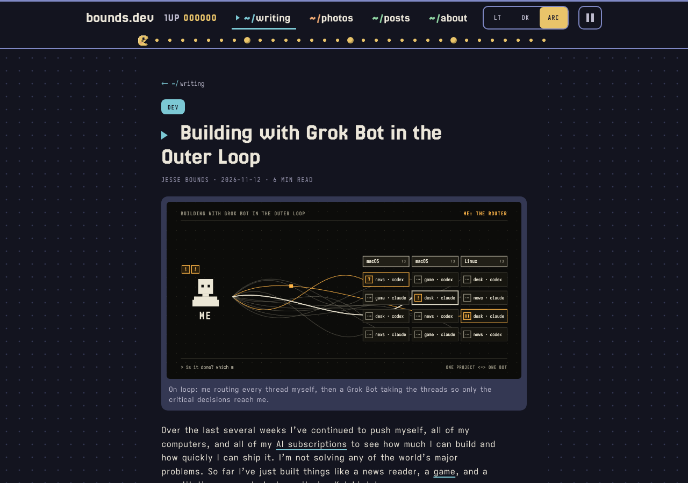 | 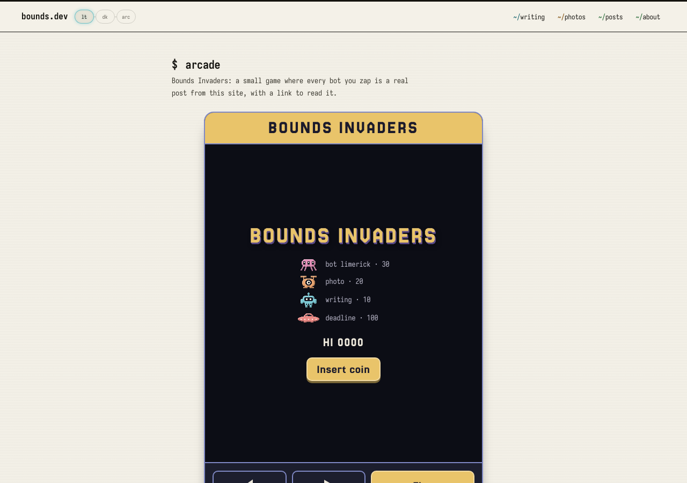 |
| A post in arcade | `/arcade/` in the light theme: the page is light, the cabinet is dark |
| 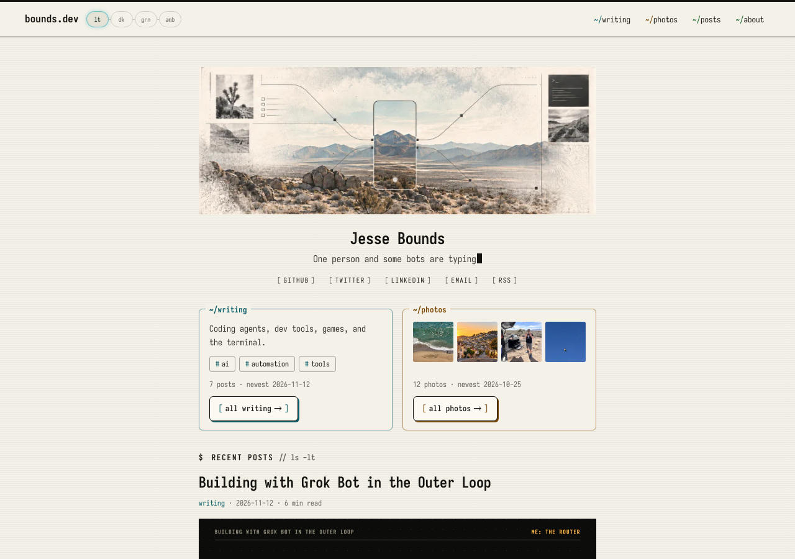 | 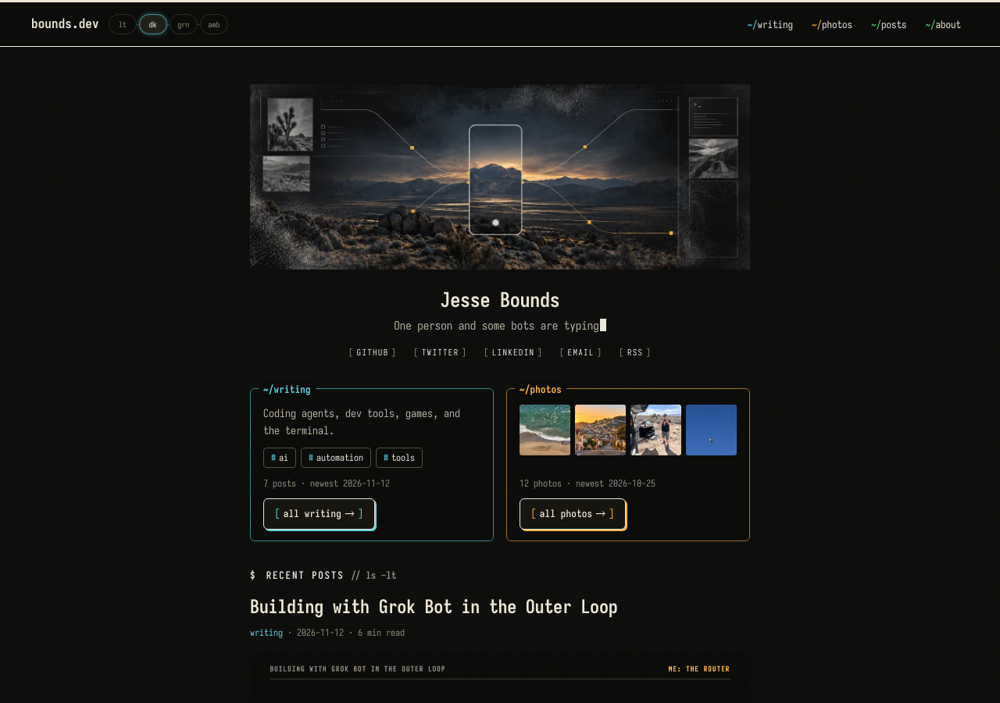 |
| Production, light, for comparison with the first figure | Production, dark |
